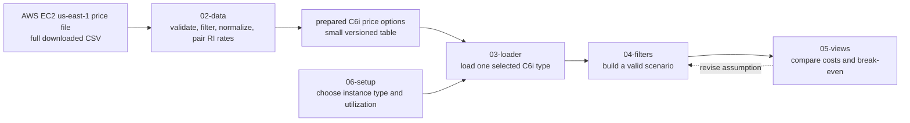

# Design: RI Commitment Explorer

## Scope and design principles

This design implements the public-price scenario in `00-vision.md`. The tool is deliberately limited to Linux, shared-tenancy, used, non-bare-metal C6i EC2 instances in `us-east-1`; it compares On-Demand with one-year and three-year **Standard** RIs. It reports every cost **per C6i instance-equivalent**, so the user is not shown a made-up Riot fleet total. The public AWS price list is an input to a scenario, not a statement of Riot's bill or a purchase recommendation.

The design follows three rules. First, raw AWS data is prepared once, because the regional EC2 file is large and an RI price is assembled from rate components. Second, every calculation is a pure function of one prepared price option and one utilization assumption, so the math can be tested without Streamlit. Third, the running application reads only a small prepared C6i table and never reads the raw price CSV after startup.



## Shared contracts and calculations

`02-data` produces one `PreparedPriceOption` row for every comparable RI choice for one C6i instance type. Its fields are `price_list_version`, `publication_date`, `instance_type`, `term_years`, `purchase_option`, `offering_class`, `on_demand_hourly_usd`, `ri_upfront_usd`, `ri_hourly_usd`, and `effective_ri_hourly_usd`. The On-Demand baseline is repeated on each RI row so all downstream modules need one table only. `offering_class` must be `standard`; `term_years` must be 1 or 3; and currency must be USD.

`04-filters` creates a `Scenario` with exactly two user inputs: `instance_type` and `utilization` as a decimal from 0 to 1. It receives the selected instance type's prepared options from `03-loader`; it does not open a file or alter the price table. `05-views` receives the scenario and its options, then returns a comparison row per payment option.

For each option, use the following explicit conventions:

```text
term_hours               = 8,760 × term_years
effective_ri_hourly      = ri_hourly + ri_upfront / term_hours
on_demand_annual_cost    = on_demand_hourly × 8,760 × utilization
ri_annualized_cost       = effective_ri_hourly × 8,760
annual_savings_vs_od     = on_demand_annual_cost - ri_annualized_cost
break_even_utilization   = effective_ri_hourly / on_demand_hourly
```

The RI is displayed as economical under the stated assumption only when utilization is at least its break-even utilization and annual savings are positive. A 3-year option is annualized for comparison, but its full term and upfront commitment remain visible.

## Module inputs and outputs

| File | Input | Output | Must not do |
| --- | --- | --- | --- |
| `02-data` | Full regional EC2 CSV and its five metadata rows | Versioned `PreparedPriceOption` table and validation report | Build UI or infer Riot usage |
| `03-loader` | Prepared table and selected C6i instance type | In-memory options for that type, or an explicit empty state | Read the raw CSV on a widget change |
| `04-filters` | Available instance types, user selection, utilization | Valid `Scenario` | Recalculate or mutate source prices |
| `05-views` | `Scenario` and prepared options | Comparison table, cost/savings view, break-even view, limitation notice | Claim a purchase recommendation |
| `06-setup` | Available types and input constraints | Initial selection controls, empty state, and scope warning | Hide the list-price limitation |

## Data preparation contract

`02-data` reads the full `data/ec2_us-east-1.csv`, not the sample files. It reads the first five rows separately to retain the AWS publication date and version, then reads the table with `skiprows=5`, `dtype=str`, `keep_default_na=False`, and `low_memory=False`. The source is filtered to `Product Family = Compute Instance`, `Region Code = us-east-1`, `Operating System = Linux`, `Tenancy = Shared`, `CapacityStatus = Used`, `Pre Installed S/W = NA`, and `Instance Type` values beginning `c6i.`. This excludes `c6i.metal` because it is a bare-metal product family; the first release must state that boundary rather than silently mixing it in.

For the On-Demand baseline, retain the one `TermType = OnDemand`, `Unit = Hrs` rate per comparable instance type. For RI options, retain `TermType = Reserved`, normalize `1 yr`/`1yr`, `3 yr`/`3yr`, and the spacing variants of the three payment options, then keep only normalized `OfferingClass = standard`. Group the RI components by `SKU` and `OfferTermCode`: the `Hrs` price is the recurring rate and the `Quantity` price is the upfront fee. A No Upfront option may have no `Quantity` row, in which case its upfront fee is exactly zero. An option with no unique hourly component, conflicting components, or no matching On-Demand baseline is excluded and reported in validation rather than guessed.

The prepared table and its validation report live under the ignored `data/` directory. Keeping the full CSV and all intermediate processing outside the UI ensures that a utilization change is instant and reproducible from the recorded source version.

## Initial view, interaction, and limits

The initial page identifies the scope as public AWS list prices for Linux C6i in `us-east-1`, exposes an instance-type selector and a utilization input, and explains that no recommendation is available until both inputs are valid. Utilization accepts only values from 0% through 100%. Once valid, the views show the On-Demand baseline beside each available one-year and three-year Standard RI payment option, including upfront payment, annualized cost, annual savings versus the stated On-Demand scenario, and break-even utilization. Changing either input reruns only the pure calculation and rendering steps.

Every view keeps the file version visible and repeats the decision boundary: private discounts, credits, existing commitments, Savings Plans, actual usage, performance requirements, and demand forecasts are not in the public price list. The next decision is therefore to investigate a promising option with Riot's internal usage and billing data, not to buy directly from this screen.
