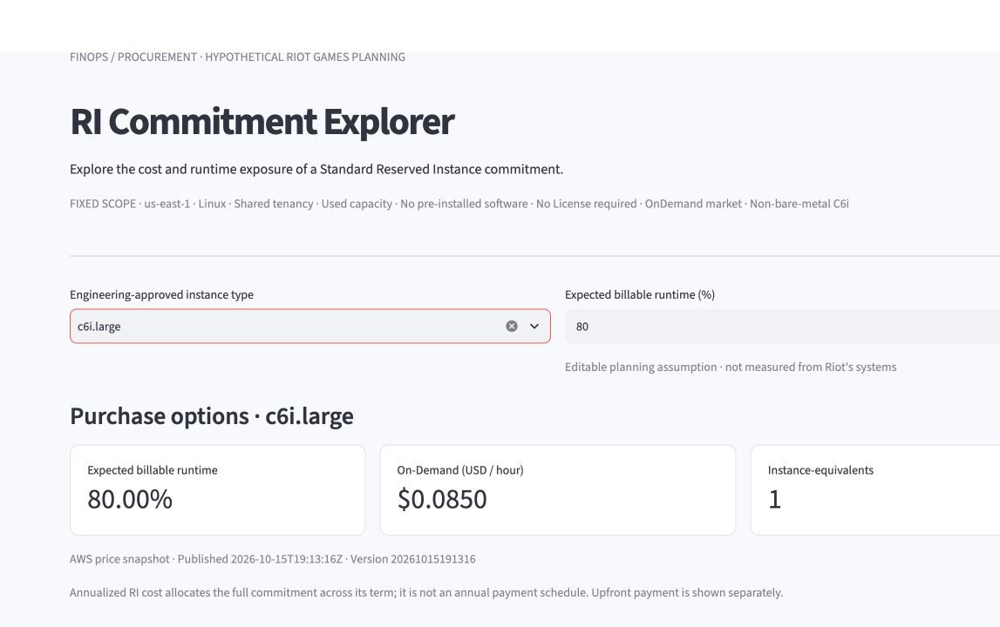
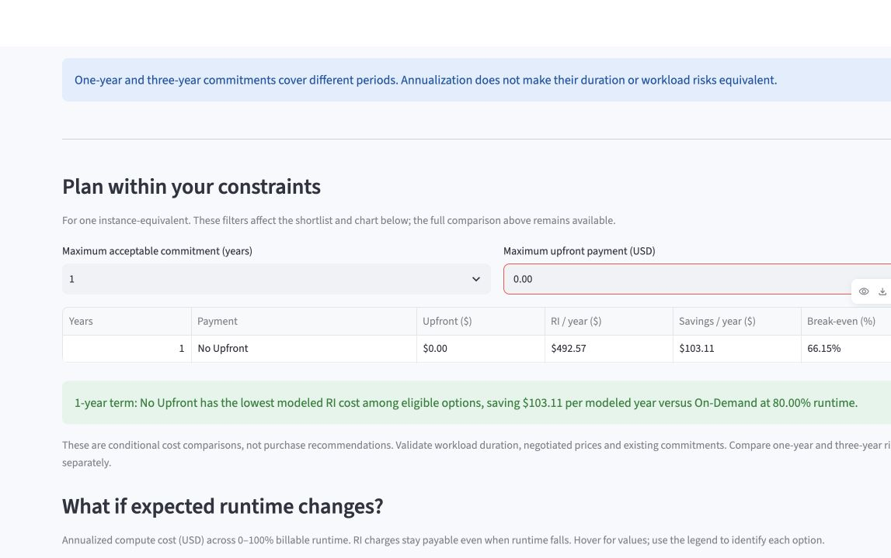
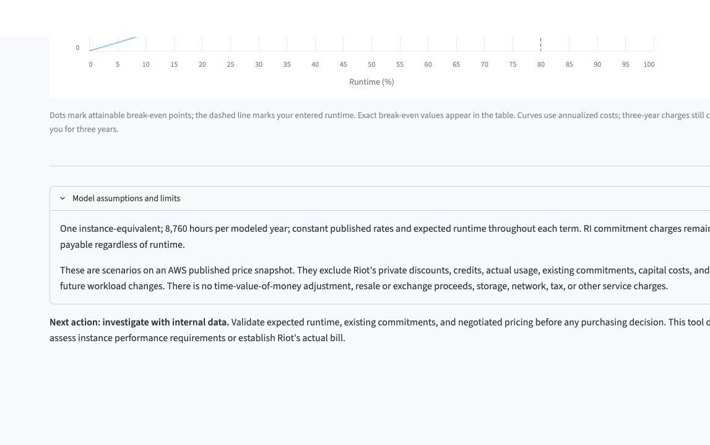

# Priya: Standard RI or Savings Plan?

## Bottom line

Priya should **not approve a Standard Reserved Instance from this app alone**. The app is useful for screening whether a particular Standard RI beats public On-Demand pricing. It does not compare that RI with Savings Plans, even though Priya expects the workload's instance family and AWS Region may change. She should compare the app's RI result with the account-specific Savings Plans recommendation and Engineering's migration plan before committing.

## 1. Person and decision

Priya is a fictional FinOps lead at a hypothetical game studio. Engineering expects one compute workload to run steadily during a game launch, but the instance family and AWS Region may change as the service scales. Priya must decide whether to investigate the Standard RI shown by the team's app or use a more flexible Savings Plan instead.

This person, company and workload are case assumptions, not facts about Riot Games or a real AWS account. The decision differs from the team's other cases because it compares commitment products rather than testing runtime, upfront budget, sizing, existing coverage or a finite project horizon.

## 2. Real decision process

The FinOps Foundation's [Rate Optimization capability](https://www.finops.org/framework/capabilities/rate-optimization/) says FinOps should coordinate with Engineering on future resource plans, evaluate resource-based commitments such as RIs and spend-based commitments such as Savings Plans, and match restrictions to validated demand.

AWS's [Savings Plans types](https://docs.aws.amazon.com/savingsplans/latest/userguide/plan-types.html) says Compute Savings Plans can continue to apply across EC2 family, size and Region changes. AWS's [RI and Savings Plans comparison](https://docs.aws.amazon.com/savingsplans/latest/userguide/sp-ris.html) distinguishes an hourly spend commitment from a configuration-based RI. [Savings Plans recommendations](https://docs.aws.amazon.com/savingsplans/latest/userguide/sp-recommendations.html) use an AWS account's past usage to estimate spend, savings and a recommended commitment.

Priya therefore has three relevant alternatives: remain On-Demand while uncertainty is high, buy a Standard RI after confirming the workload will stay in scope, or investigate a Savings Plan with account-specific data.

## 3. Live-app evidence

In the public [RI Commitment Explorer](https://dso576-project-m10-dgvbvbjl9c4y23u6decrwc.streamlit.app/), I selected `c6i.large` and 80% expected billable runtime. The page fixes the comparison to `us-east-1`, Linux, shared tenancy and public Standard RI prices.

With a one-year maximum commitment and $0 maximum upfront payment, the only eligible RI was one-year No Upfront:

| Measure | Result |
|---|---:|
| On-Demand baseline | $595.68/year |
| Standard RI cost | $492.57/year |
| Modeled savings | $103.11/year |
| Break-even runtime | 66.15% |

The independent `verify_priya.py` check reproduced the unrounded values: $595.6800 On-Demand, $492.5748 RI, $103.1052 savings and 66.1529411765% break-even. It also makes the missing comparison explicit: there is no Savings Plan rate or account recommendation among the inputs.

## 4. Reading the result

The $103.11 is correct only for the app's modeled choice: one uncovered `c6i.large`, 80% runtime, public prices and Standard RI versus On-Demand. It is not proof that the RI is the best AWS commitment.

This is a **which-rows-belong** problem. Compute Savings Plans, EC2 Instance Savings Plans, other families and Regions, private prices, existing coverage and account usage history are outside the table. The 80% runtime is also a user-entered proxy rather than observed account demand. The green shortlist sentence can therefore be accurate inside the app and still mislead Priya about her broader decision.

The app itself says that it excludes actual usage, existing commitments, private discounts and future workload changes and that the next action is to investigate with internal data.

Priya still needs Engineering's migration plan, account-specific usage and coverage, negotiated pricing, term constraints and any capacity-reservation requirement. A Savings Plans recommendation could change the decision because it measures a flexible alternative that the app does not contain.

## 5. Verdict

**Break for Priya's RI-versus-Savings-Plans decision.** The app proves only that one Standard RI is cheaper than public On-Demand pricing in its fixed scope. Priya may use it to screen the RI side, but she should not approve that RI until she compares the account-specific Savings Plans recommendation and confirms the workload plan with Engineering.

The related team change request is **CR-04: Put the RI-only scope beside the shortlist verdict**. It asks the app to state, next to the green result, that the shortlist compares Standard RIs with On-Demand only and to direct users to account-specific Savings Plans analysis when workload flexibility matters.

*Live screenshots captured and sources accessed November 8, 2026.*
