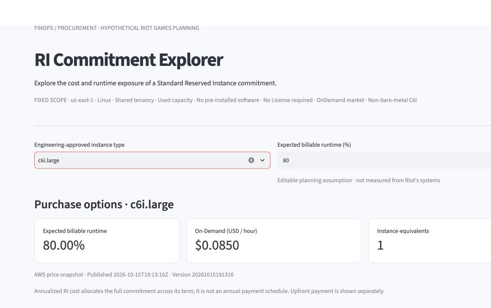
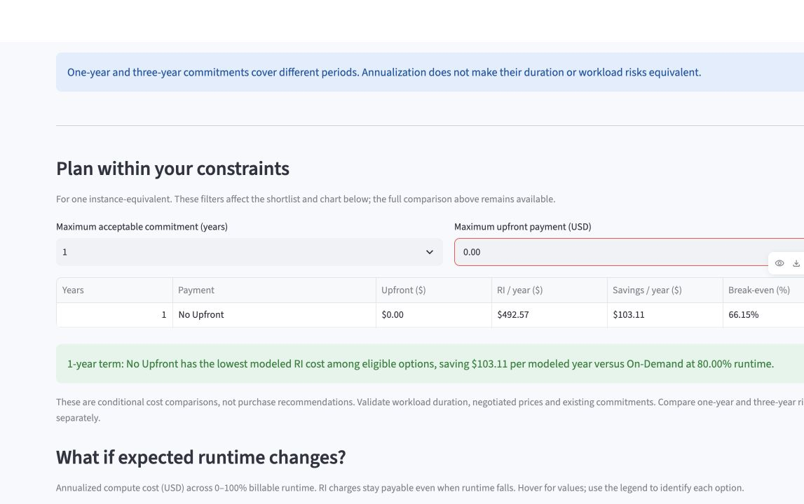
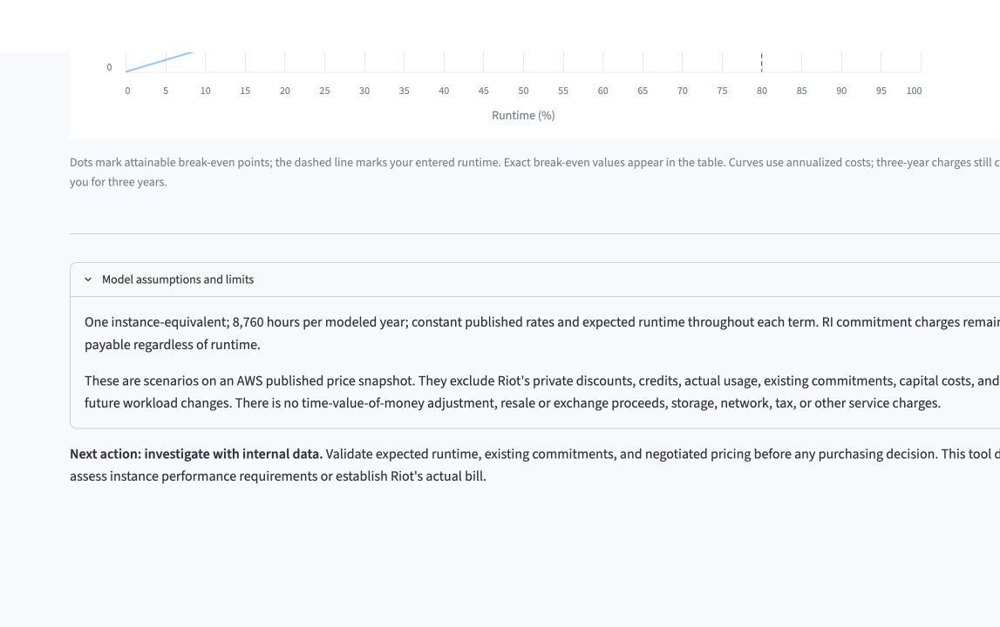

# Priya: should a flexible workload use a Standard RI or a Savings Plan?

## Bottom line

Priya should **not approve a Standard Reserved Instance from this app alone**. The app is useful for checking whether a particular Standard RI beats public On-Demand pricing under a stated runtime assumption. It does not compare the Standard RI with Savings Plans, even though Priya expects the workload's instance family and AWS Region may change. Priya should use the result as an RI screening calculation, then compare it with the account-specific Savings Plans recommendation and Engineering's migration plan before committing.

## 1. The person and the decision

Priya is a fictional FinOps lead at a hypothetical game studio. Engineering expects one compute workload to run steadily during an upcoming game launch, but its instance family and AWS Region may change as the service scales and the team learns more about performance. Priya must decide whether to investigate the Standard Reserved Instance options shown by the RI Commitment Explorer or use a more flexible Savings Plan instead. Choosing from the app's RI-only shortlist without comparing the alternative could lock the team into a commitment whose scope does not fit the workload.

The person, company, workload and expected changes are case assumptions, not facts about Riot Games or an actual AWS account. This case is distinct from the existing team cases: it examines the product choice between a Standard RI and Savings Plans rather than runtime uncertainty, upfront-budget feasibility, instance sizing, existing coverage or a finite project horizon.

## 2. How this decision is made today

FinOps does not make this choice from a public price discount alone. The FinOps Foundation's [Rate Optimization capability](https://www.finops.org/framework/capabilities/rate-optimization/) says FinOps should work with Engineering on current and future resource plans, evaluate both resource-based commitments such as RIs and spend-based commitments such as Savings Plans, and match commitment restrictions to validated demand. More restrictions can increase the discount while also increasing the risk of unused commitment.

AWS documents the product difference directly:

- [Savings Plans types](https://docs.aws.amazon.com/savingsplans/latest/userguide/plan-types.html) explains that Compute Savings Plans can continue to apply when EC2 instance family, size, Region, operating system or tenancy changes, while EC2 Instance Savings Plans are tied to an instance family in a selected Region.
- [Compute Savings Plans and Reserved Instances](https://docs.aws.amazon.com/savingsplans/latest/userguide/sp-ris.html) explains that Savings Plans are hourly spend commitments, while Standard RIs are configuration-based commitments. It also notes that Savings Plans do not create capacity reservations by themselves.
- [Understanding Savings Plans recommendations](https://docs.aws.amazon.com/savingsplans/latest/userguide/sp-recommendations.html) explains that AWS Cost Explorer recommendations are based on the account's past usage and show projected spend and estimated savings for a recommended hourly commitment.

Those sources make three alternatives relevant to Priya: keep the workload On-Demand while uncertainty remains; buy a Standard RI after confirming the workload will stay inside its scope; or investigate a Savings Plan using account-specific usage and recommendations. The public app can calculate the first comparison but not the third alternative.

## 3. The app in use

I opened the team's public [RI Commitment Explorer](https://dso576-project-m10-dgvbvbjl9c4y23u6decrwc.streamlit.app/) and selected `c6i.large` with 80% expected billable runtime. The page identifies a fixed scope of `us-east-1`, Linux, shared tenancy and Standard RI pricing from an AWS public price snapshot.



I then set the maximum acceptable commitment to one year and the maximum upfront payment to $0. The only eligible row was one-year No Upfront. The app reported:

| Measure | Live-app result |
|---|---:|
| On-Demand baseline | $595.68 per modeled year |
| One-year No Upfront RI | $492.57 per modeled year |
| Modeled annual savings | $103.11 |
| Break-even runtime | 66.15% |



I reproduced those numbers in `verify_priya.py` without importing the app's calculation code. The check uses the price-snapshot rates already documented in the team's validation: $0.085 per On-Demand hour and $0.05623 per one-year No Upfront RI hour.

```text
On-Demand annual cost: $595.6800
RI annual cost:        $492.5748
Modeled annual saving: $103.1052
Break-even runtime:    66.1529411765%
Savings Plan result:   unavailable — no Savings Plan rates or account recommendation are inputs
```

One row in this calculation is one purchase option for one `c6i.large` instance-equivalent in the fixed public-price scope. The result includes the Standard RI and On-Demand rows for that configuration. It leaves out Compute Savings Plans, EC2 Instance Savings Plans, other instance families and Regions, private prices, credits, existing commitments and the account's real usage history.

## 4. What the result means for Priya

The $103.11 is a valid conditional comparison: if this workload is an uncovered `c6i.large` in `us-east-1`, if 80% runtime is a good forecast, if public prices apply, and if Priya is choosing only between this RI and On-Demand, the one-year No Upfront RI costs less in the model. The 66.15% value says where the modeled one-year RI and On-Demand annual costs are equal.

It is **not** the savings from choosing the best AWS commitment product. Savings Plans are outside the row universe, so the eligible-set minimum is not a minimum across Priya's real alternatives. This is primarily a **kind 2: which rows belong** problem. It also has a proxy limitation: the 80% entry is an editable assumption, not observed or forecast account usage.

Priya could be misled by the green sentence that says the RI is the lowest modeled eligible option. That sentence is correct inside the RI-only filters, but it could be read as approval to buy an RI. A different number could change the decision: an account-specific Savings Plans recommendation may show a flexible commitment that still covers usage after the family or Region changes. The public app cannot calculate that comparison because it has neither Savings Plans rates nor the account history required for the recommendation.

The app itself supports this caution. Its limitations say that the scenario excludes actual usage, existing commitments, private discounts and future workload changes, and its next action is to investigate with internal data.



Outside the app, Priya still needs Engineering's expected family and Region changes; the account's historical and projected eligible spend; existing RI and Savings Plans coverage; private pricing and credits; term and payment constraints; and any capacity-reservation requirement. Those facts determine whether flexibility is worth more than the narrow RI discount.

## 5. Verdict and change request

**Verdict: break for Priya's RI-versus-Savings-Plans decision.** The app proves only that one specific Standard RI is cheaper than public On-Demand pricing in its modeled scope. It does not answer Priya's actual product-choice question, so she should not use it to approve a Standard RI. She may use it to screen the RI side of the comparison, then obtain the account-specific Savings Plans recommendation and confirm the workload plan with Engineering before deciding.

I added **CR-04: Put the RI-only scope beside the shortlist verdict** to `change-requests.md`. The requested change keeps the existing calculations but makes the product boundary visible at the moment a reader sees a green savings result. It also points the reader to an account-specific Savings Plans comparison when flexibility matters.

## Reproduction

Run the independent arithmetic check from the team repository:

```bash
python3 cases/case-priya-savings-plans-vs-ri/verify_priya.py
```

The screenshots were captured from the public app on November 8, 2026. Source pages were accessed the same day.
