# RI Commitment Explorer - Validation

**Team project:** `XingJia-Lyu/dso576-project-M10`  
**Integrated:** November 8, 2026  
**Case personas:** Jordan, Alex, Winnie, Casey and Maya

RI Commitment Explorer helps a FinOps team examine whether a Standard Reserved Instance (RI) commitment costs less than On-Demand for an engineering-approved Amazon EC2 instance. The intended organizational setting is Riot Games, treated as a hypothetical customer, not an actual partner or validated user. The decision is whether an eligible RI merits further internal review given expected billable runtime, an upfront-payment limit and a maximum acceptable commitment term. Committing too much can create charges for unused resources; committing too little can forgo discounts.

The app uses a processed AWS public price snapshot for one Linux/shared-tenancy C6i instance-equivalent in `us-east-1`. It compares On-Demand with one- and three-year Standard RI payment options. It does not access Riot's account, actual usage, private prices or existing commitments. Its outputs are conditional compute-cost scenarios, not Riot's actual bill or a complete procurement recommendation.

**Public team-app link:** [RI Commitment Explorer - official team deployment](https://dso576-project-m10-dgvbvbjl9c4y23u6decrwc.streamlit.app/)

> **Evidence status:** Five submitted case narratives are integrated below. Twenty-two supplied case screenshots and the prior test-result screenshot are included. Alex's three new captures document the 80%/50% cost reversal and the 80% constrained shortlist. Case observations and access checks are attributed to their contributors; this integration did not independently rerun the public app or authenticate deployed commits. Export the completed document as root-level `validation.pdf` before submission.

## 1. Design

### 1.1 Users, context and evidence

The primary intended users are Riot Games' FinOps practitioners reviewing cloud purchase commitments with Engineering, Finance and Procurement. AWS's Riot case study documents the company's AWS infrastructure and attention to resource allocation, automatic scaling and infrastructure cost [R1]. That makes the industry setting plausible; it does not demonstrate that Riot uses this app, purchases the modeled configurations, or has the exact needs assumed here.

The FinOps Foundation describes rate optimization as evaluating commitment discounts against demand, financial constraints and flexibility, coordinated across these roles [R2]. AWS documents that RIs require a one- or three-year term and that recurring charges remain payable even when resources are not used [R3]. Together these sources support comparing the whole obligation rather than choosing an advertised hourly discount. Our inference is that a clear cost threshold and constraint-aware shortlist can assist an early purchase review. We have not interviewed Riot staff or measured adoption, decision quality or time saved.

Engineering approval is a prerequisite supplied by the user: the app does not identify a sufficiently powerful instance. The intended next action is to validate demand, available discount coverage and actual contractual pricing internally. Engineering workload owners are relevant secondary users and reviewers. The cases below cover procurement, runtime uncertainty, configuration budgeting, existing coverage and finite project life. These are constructed decision scenarios, not user-research interviews.

### 1.2 Why the features serve the decision

| Feature | User need and design reason | Evidence and boundary |
|---|---|---|
| Instance selection within a fixed product scope | Compare payment terms for the same approved configuration rather than mix incompatible products | `dashboard.py`, `src/filter_rates.py`; the app labels the scope and does not assess performance |
| Editable expected billable runtime, 0-100% | Expose how many modeled hours require capacity instead of silently assuming continuous use | The input help distinguishes runtime from CPU utilization; the 80% and 50% checks in Sections 2-3 demonstrate the consequence |
| Separate one-year and three-year tables | Show each duration's costs without making a longer obligation appear risk-equivalent | AWS's term definitions [R3]; annualization is an accounting comparison, not an equal-risk comparison |
| Upfront, recurring and effective rates with annualized cost, savings and break-even | Explain payment timing and the full obligation; make a negative saving visible | Independent arithmetic in Section 3 and payment rules [R3] |
| Maximum commitment and maximum upfront-payment filters | Remove options outside the user's stated purchase constraints | `src/decision.py`; a one-year/$0 filter retains one option for `c6i.large` |
| Eligible shortlist and explanation within each term | Identify the lowest modeled cost among eligible RIs while explicitly comparing it with On-Demand | The explanation handles savings, equality and higher cost. It does not rank commitment risk across terms |
| Runtime sensitivity graph | Show the downside of underusing a commitment and the cost crossover | The RI line stays flat, On-Demand rises with runtime, dots mark attainable break-even points and the dashed line marks the current assumption |
| Snapshot metadata and visible assumptions | Make provenance, dates and excluded costs available when interpreting results | October snapshot metadata is visible in the case screenshots; archived rates are not a live quote |
| Compact summary tables and expandable payment details | Keep decision measures readable while retaining detailed rates/status | Supplied live screenshots show the revised metric labels and comparison layout. Some shortlist headings can still truncate on narrow screens; the full metrics are defined below |

The first six comparison measures and the original data pipeline were already present in the supplied starting build. Our additions are the constraint filters, shortlist, per-term conditional explanations, runtime sensitivity view and their tests, plus presentation improvements. We do not claim inherited features or inherited tests as newly built work.

### 1.3 Alternatives considered and scope deliberately excluded

| Alternative or extension | Decision for this MVP | Reason |
|---|---|---|
| Spreadsheet based on the same prices | A valid independent comparison, not an inferior source by definition | It can reproduce every modeled result; the app packages the controls and comparisons consistently but has no measured usability advantage |
| AWS Cost Explorer recommendations | Complement rather than replace | They use account-specific historical usage; AWS notes that historical usage is assumed to represent the future [R4]. The app has no such account evidence |
| Savings Plans, Spot and other EC2 purchase choices | Acknowledge but do not optimize in this MVP | Their data and operational requirements are outside the prepared table. AWS recommends Savings Plans over RIs for flexibility [R3], so an RI-only minimum cannot be called the best AWS purchase |
| More regions, instance families and operating systems | Exclude from the fixed-scope prototype | Requires additional comparable data and engineering suitability checks; a price-only ranking would be misleading |
| Automatic purchase recommendation or purchase execution | Do not provide | Demand, private prices and existing commitment coverage are absent; a favorable modeled result is insufficient approval evidence |
| Workload forecasting or CPU-based runtime inference | Do not provide | The dataset contains prices, not workload telemetry. The input is an assumption and not a forecast |
| Fleet allocation, size flexibility and existing discount optimization | Do not model | Requires account-level matching, sharing and coverage information. One instance-equivalent is an illustration, not a fleet strategy |
| Net present value, financing, resale/exchange proceeds and changing rates | Explicitly exclude | Would require further assumptions or evidence. The MVP uses constant rates/runtime and undiscounted costs |
| Existing-coverage checkpoint | Open, CR-02 | Casey shows that uncovered On-Demand savings are not incremental savings for an already-covered workload |
| Finite-project horizon comparison | Open, CR-03 | Maya needs full obligations over a finite demand horizon, with an On-Demand remainder, rather than annualized prices alone |

### 1.4 Research references

Official sources consulted November 7, 2026; each supports the specific claims above, not an observed Riot workflow.

- **[R1] AWS:** [Riot Games Cuts $10M Annual Infrastructure Costs by Migrating to Amazon EKS](https://aws.amazon.com/solutions/case-studies/riot-games-case-study/). Organizational background; no part of those reported savings is attributed to this app.
- **[R2] FinOps Foundation:** [Rate Optimization](https://www.finops.org/framework/capabilities/rate-optimization/). Industry basis for coordinating commitment strategy, demand and financial constraints.
- **[R3] AWS:** [Reserved Instances for Amazon EC2 overview](https://docs.aws.amazon.com/AWSEC2/latest/UserGuide/ec2-reserved-instances.html). Terms, payment obligations, purchasing limits and the Savings Plans alternative.
- **[R4] AWS:** [Accessing reservation recommendations](https://docs.aws.amazon.com/cost-management/latest/userguide/ri-recommendations.html). Account-based recommendations and their historical-usage assumption.

## 2. Cases

### 2.1 Decision coverage and evidence

| Persona | Distinct decision | Evidence and verdict |
|---|---|---|
| Jordan — Junxuan Chen | One-year payment method at 80% runtime; $300 versus $460 upfront cap | Three screenshots; constrained comparison holds up; no new request |
| Alex | c6i.16xlarge runtime risk: 80% versus 50%, one year/$0 upfront | Three screenshots and independent calculation; no new request |
| Winnie | Compare two engineering-approved sizes under identical constraints | Ten screenshots; cost-only comparison holds up; no new request |
| Casey | Avoid buying overlapping coverage for an already-covered workload | Three screenshots; CR-02 proposes an explicit coverage checkpoint |
| Maya — submitted in Kelven's case package | Match commitment length to an 18-month migration | Three screenshots; CR-03 proposes a finite-horizon comparison; formal case |

All five narratives are retained, including context, sources, alternatives, inputs, interpretation and verdict. They test different decision quantities, even where the instance or price inputs overlap. Casey and Maya are difficult boundary cases where correct app arithmetic is insufficient for the actual decision. Source access and live observations below are contributor-reported. Missing evidence is not replaced with screenshots from another scenario.

### 2.2 Jordan


**Prepared by:** Junxuan Chen  
**App:** RI Commitment Explorer  
**Prepared:** November 7, 2026

> **Evidence status:** Three screenshots supplied by Junxuan Chen on November 7, 2026 document the selected configuration and the $300/$460 budget states. The displayed figures agree with the independent arithmetic below. The author supplied these as captures from the official team deployment linked in Section 3; the reviewer did not independently verify anonymous access or the exact deployed commit.

#### 1. The person and the decision

Jordan is a fictional cloud procurement coordinator at a hypothetical game studio, preparing a payment-option proposal for one engineering-approved Linux `c6i.large` instance-equivalent in `us-east-1`. The workload review supplies an 80% expected billable-runtime assumption and allows a maximum commitment of one year; Jordan must choose which one-year Standard RI payment option, if any, to advance under a **$300 upfront-payment limit**. The decision is whether Partial Upfront offers the lowest modeled annual cost within that limit, or whether Jordan should retain No Upfront or seek additional approval for All Upfront. Choosing an infeasible option would exceed the initial-payment authority; ignoring feasible alternatives could increase modeled cost.

The person, studio, budget, approved configuration, one-year limit and runtime estimate are case assumptions, not observations about a real employee or Riot's internal policy. The app's overall intended audience remains a hypothetical Riot Games FinOps team; this case examines a collaborating procurement role. Its central decision is **payment method under an upfront budget**, with runtime held at 80%.

#### 2. Their real situation and alternatives

Procurement decisions need input from financial and technical reviewers. The FinOps Foundation's Rate Optimization guidance assigns Finance a role in modeling prepayment and budget impacts, and Procurement a role in comparing pricing and commitment options [1]. This supports Jordan's need to distinguish an initial cash limit from a total-cost objective, but it does not establish the fictional studio's workflow. AWS's RI documentation distinguishes All Upfront, Partial Upfront and No Upfront and states that the term creates payment obligations regardless of use [2]. A zero or smaller upfront payment therefore does not mean a smaller total obligation. The fixed one-year horizon and 80% runtime simplify the comparison; they do not eliminate the need to validate the underlying workload.

Jordan can use a spreadsheet with Finance to reproduce the cost comparison and assess payment timing; ask Engineering and FinOps to verify demand, compatibility and uncovered usage; or consult authorized AWS Cost Explorer reservation recommendations. Those recommendations use account-specific historical usage and assume it represents future usage rather than forecasting demand [3]. AWS also recommends Savings Plans over RIs for flexibility [2]. The app is useful for this narrow published-price comparison but does not establish that an RI is the best product overall. Private rates, existing commitments, financing costs, internal approval rules and cash-flow constraints can change the real decision.

**Sources - official pages reviewed November 7, 2026:**

1. **FinOps Foundation**, [Rate Optimization](https://www.finops.org/framework/capabilities/rate-optimization/). Supports cross-functional review, prepayment analysis and financial constraints; not evidence of a specific studio's policies.
2. **Amazon Web Services**, [Reserved Instances for Amazon EC2 overview](https://docs.aws.amazon.com/AWSEC2/latest/UserGuide/ec2-reserved-instances.html). Supports term/payment rules, the continuing obligation and the Savings Plans alternative.
3. **Amazon Web Services**, [Accessing reservation recommendations](https://docs.aws.amazon.com/cost-management/latest/userguide/ri-recommendations.html). Supports the account-based alternative and its historical-usage limitation.

#### 3. The app in use

**Live link:** [RI Commitment Explorer - official team deployment](https://dso576-project-m10-dgvbvbjl9c4y23u6decrwc.streamlit.app/)

**Observation date:** November 7, 2026. The three supplied screenshots show c6i.large at 80% runtime, the one-year comparison and the two budget states. Captioned observations below are read from these captures; the independent calculations provide a separate arithmetic check. A caption records selections not visible in each individual image.

##### Step A: Fix the configuration and inspect payment options

| Setting | Value | Reason |
|---|---|---|
| Instance type | `c6i.large` | Assumed technical approval; no sizing recommendation is made |
| Expected billable runtime | `80%` throughout this case | Common assumption for all payment options, not measured demand or CPU utilization |
| Maximum acceptable commitment | `1 year` | Case's permitted horizon |
| Initial maximum upfront payment | `$300` | Case's initial-payment authority; not the total annual budget |
| Modeled quantity | One instance-equivalent | Consistent comparison unit |

At the recorded rates, On-Demand costs **$595.68 per modeled year** at 80% runtime. The one-year options have the following values (full-precision recurring rates are source inputs used for the independent check; the screenshot displays the other columns):

| Payment option | Upfront payment | Recurring RI USD/hour | Annualized RI cost | Annual savings vs On-Demand | Eligible at $300? |
|---|---:|---:|---:|---:|---|
| No Upfront | $0 | $0.05623 | $492.57 | $103.11 | Yes |
| Partial Upfront | $235 | $0.02678 | $469.59 | $126.09 | Yes |
| All Upfront | $460 | $0 | $460.00 | $135.68 | No |

The unfiltered one-year table provides the complete comparison; the shortlist below applies the stated budget and term constraints. Three-year rows in the original comparison are outside this decision, even if their annualized costs are lower.

**Figure 1.** c6i.large, 80% billable runtime and one instance-equivalent. The displayed October 15, 2026 snapshot and complete one-year comparison establish the rate scope and all three payment options. The On-Demand annual baseline is $595.68.

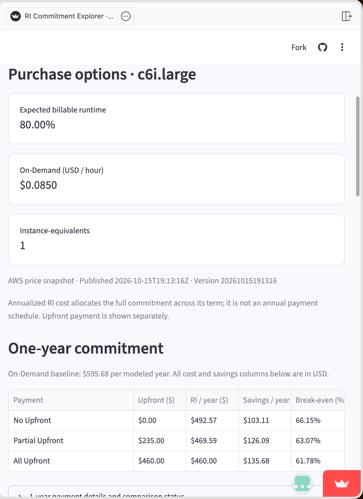

##### Step B: Apply the $300 limit

With maximum term **1 year** and maximum upfront payment **$300**, the displayed shortlist contains **No Upfront and Partial Upfront only**. Partial Upfront has the lowest annualized RI cost within the eligible set: **$469.59**, with **$126.09** annual savings versus On-Demand at 80%. Relative to No Upfront, it requires $235 initially but reduces the modeled full-year total by **$22.98**. That reduction is a cost difference, not a return-on-investment calculation.

**Figure 2.** c6i.large at 80% runtime, maximum term one year and upfront cap $300. Two options remain. The app identifies Partial Upfront as the lowest-cost eligible RI, with $126.09 modeled annual savings.

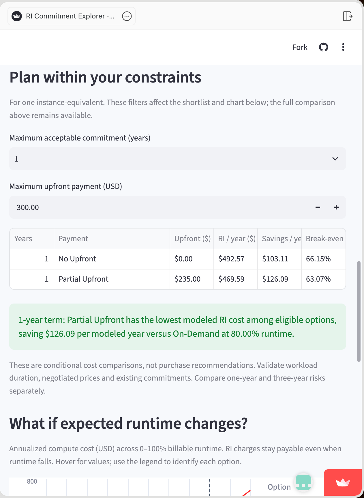

##### Step C: Evaluate whether a budget exception is worth discussing

Raise the cap to **$460**, retaining the other settings. All three one-year payment options are displayed as eligible, with All Upfront lowest on modeled annual cost. It needs **$225 more upfront than Partial Upfront** but reduces the modeled annual total by only **$9.59**. Jordan should ask Finance whether that small incremental cost reduction justifies the additional initial payment; the app does not include a financing rate or decide that trade-off.

**Figure 3.** Same c6i.large/80% scenario, maximum term one year and upfront cap $460. All three payment methods are eligible. The app selects All Upfront on modeled annual cost, with $135.68 savings versus On-Demand. The row order does not determine eligibility or the cost minimum.

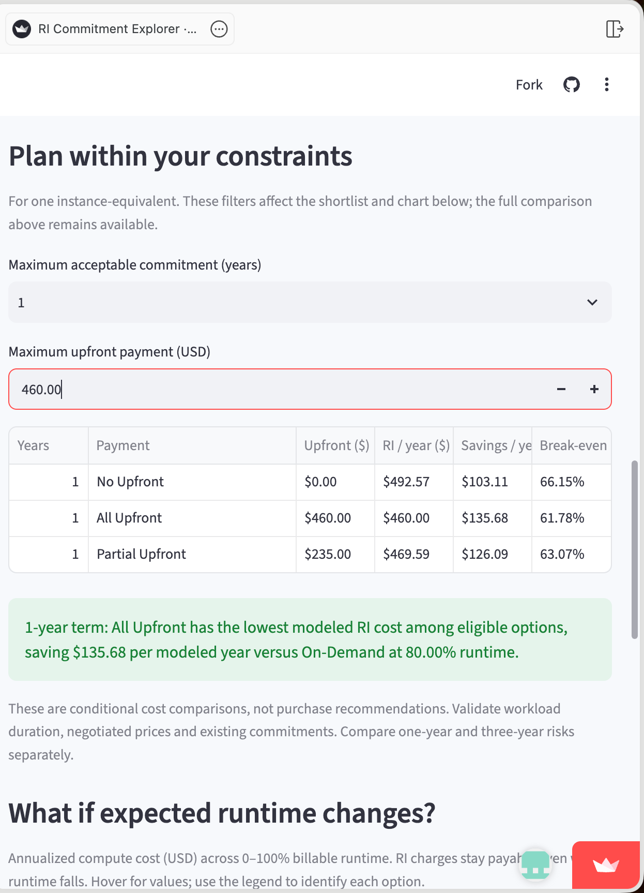

#### 4. Reading the result for their decision

##### Does the number measure what this person cares about?

The annualized RI cost measures the undiscounted full-term compute obligation divided by term length. For the one-year options here, it equals the modeled total RI cost over that year. Upfront payment measures only the initial payment, which is the quantity constrained by Jordan's $300 cap. These two measures answer different questions: **can the option be paid for initially, and how much does the complete modeled year cost?**

This is a **kind 4, total-versus-rate** risk. Comparing upfront payments alone would overlook recurring charges; multiplying an RI hourly rate only by used hours would understate the obligation. For `F` upfront USD, `h` recurring USD/hour and 8,760 commitment hours, one-year cost is `F + h × 8,760`, regardless of the runtime estimate. On-Demand costs `p × 8,760 × 0.8` under this scenario.

A second risk is **kind 3, a proxy**: public prices and assumed runtime stand in for actual negotiated marginal cost and future eligible demand. The valid conclusion is 'Partial Upfront has the lowest modeled annual RI cost within this budget and term,' not 'this purchase is proven best for the studio.'

**Independent arithmetic:** This standalone check was executed without importing application code:

```python
from decimal import Decimal as D

hours = D('8760')
od = D('0.085') * hours * D('0.8')
options = [
    ('No Upfront', D('0'), D('0.05623')),
    ('Partial Upfront', D('235'), D('0.02678')),
    ('All Upfront', D('460'), D('0')),
]
for payment, upfront, rate in options:
    annual = upfront + rate * hours
    print(f'{payment}: annual={annual:.2f}, savings={od-annual:.2f}')
for budget in (D('300'), D('460')):
    eligible = [(f + h*hours, name) for name, f, h in options if f <= budget]
    print(f'Budget {budget}: eligible={len(eligible)}, lowest={min(eligible)[1]}')
no = options[0][1] + options[0][2] * hours
partial = options[1][1] + options[1][2] * hours
all_upfront = options[2][1]
print(f'Partial vs No: annual reduction={no-partial:.2f}')
print(f'All vs Partial: extra upfront=225.00, annual reduction={partial-all_upfront:.2f}')
```

```text
No Upfront: annual=492.57, savings=103.11
Partial Upfront: annual=469.59, savings=126.09
All Upfront: annual=460.00, savings=135.68
Budget 300: eligible=2, lowest=Partial Upfront
Budget 460: eligible=3, lowest=All Upfront
Partial vs No: annual reduction=22.98
All vs Partial: extra upfront=225.00, annual reduction=9.59
```

Partial Upfront has $234.59280 in recurring annual charges plus $235 upfront, totaling $469.59280. No Upfront totals $492.57480. Their unrounded difference is $22.98200. All Upfront costs $460, so its incremental reduction versus Partial Upfront is $9.59280. Currency is rounded once at display time. Jordan should not recompute using only the displayed rounded recurring rate of $0.0268: the full-precision rate is $0.02678.

**Price/date boundary:** Figure 1 displays publication `2026-10-15T19:13:16Z`, version `20261015191316`. A separate CSV scan of the supplied September raw file, publication `2026-09-04T23:11:17Z`, version `20260904231117`, found the same selected rate inputs for SKU `G34GXEYC28NK97K3`. These corroborate the arithmetic but do not reconstruct or authenticate the October source. Figure 1 confirms the displayed October metadata, while the comparison screenshots confirm the selected displayed amounts; these do not independently authenticate the full October raw-to-processed pipeline. Archived prices are not a live quote (**kind 5, which dates belong**).

##### Who is in the rows, and who is not?

A row represents an RI purchase option, not an observed workload, procurement transaction or employee. The provided runtime snapshot has 54 RI options across nine C6i types, two term lengths and three payment choices. The fixed scope is Linux, shared tenancy, used capacity, no preinstalled software, no license requirement and `us-east-1`. Within the selected instance, the one-year comparison has three payment options; the $300 cap admits two.

Other regions, instance families, operating systems, dedicated tenancy, Convertible RIs, Savings Plans and Spot are outside this set, as are storage, networking and taxes. This is **kind 2, which rows belong**: the eligible-set minimum cannot be generalized to every AWS product or the entire studio's cloud estate. The app is also fixed to one instance-equivalent; the $300 cap is not a portfolio-wide allocation budget.

##### What outside the data matters to this decision?

Finance must confirm the real initial-payment authority, recurring-payment affordability, cash availability and cost of capital. The app applies a nominal upfront cap, not a net-present-value or cash-flow model. The additional $225 for All Upfront might be more valuable elsewhere even though its modeled total is $9.59 lower. Conversely, an organization may prefer simpler billing or have different internal approval costs. These are decision factors, not conclusions established by the price data.

Engineering must confirm compatibility and demand for the commitment horizon. FinOps must check existing commitments, sharing, private prices, credits and alternative discount products. Eighty percent runtime is a common case assumption, not a demand guarantee or CPU utilization figure. The app does not model uncertain demand probabilities, early exit, capital costs or future rate changes. Cost Explorer's account-specific history [3] can inform this review but does not settle future workload plans.

##### What could they wrongly conclude from it?

| Misreading | Correct interpretation |
|---|---|
| '$300 is the total annual budget.' | It caps only upfront payment. The lowest eligible annual RI cost is $469.59. |
| 'No Upfront costs nothing initially, so it is cheapest.' | It still incurs $492.57 over the modeled year, more than eligible Partial Upfront. |
| 'All Upfront is cheapest, so Jordan should buy it now.' | Its $460 initial payment exceeds the current cap by $160. It requires separate authority. |
| 'Another $225 upfront saves $225.' | Relative to Partial Upfront, it reduces the modeled annual total by only $9.59. |
| 'The lowest-cost message proves the real business choice.' | It excludes financing, private prices, existing coverage and alternative products. It is a constrained nominal-cost comparison. |

#### 5. The verdict: prove or break

**Verdict: prove for this constrained payment-option comparison.** At the reference rates, Partial Upfront is the feasible one-year RI with the lowest modeled annual cost at a $300 cap. There are only two eligible RI alternatives: $469.59280 for Partial Upfront is strictly below $492.57480 for No Upfront; the $460 All Upfront option is initially infeasible. This exhaustive comparison proves the minimum within the modeled set, not an optimal real-world purchase.

Jordan should advance **Partial Upfront for financial and technical review under the existing authority**, with its $235 upfront charge and $469.59 modeled annual cost stated together. If Finance invites a budget exception, Jordan can explain that All Upfront requires another $225 initially for only $9.59 less nominal annual cost. On-Demand remains a baseline and a practical alternative if internal review does not support a commitment.

Relative to reading upfront charges alone, the app clarifies feasibility and full-term costs. A spreadsheet can reproduce the arithmetic, while Cost Explorer contributes usage and coverage evidence absent here. The app therefore supports a narrow comparison alongside those alternatives; no user study proves better decisions or greater speed. Missing information about actual prices, cash constraints and future demand cannot be recovered by further arithmetic on the public price table.

The existing budget filter, one-year table and per-term summary already support this task; **no new change request is proposed for Jordan's case**. The shortlist and messages already distinguish budget eligibility from modeled annual cost, and the remaining uncertainties require internal financial and workload evidence rather than further arithmetic on the same public rates.

The three screenshots and independent calculation support the selected payment-option comparison. Do not use this app as a total-bill forecast, financing analysis, hardware-sizing tool or ranking of all purchasing strategies. Confirm final deployment availability and export this document to PDF for the individual submission.

### 2.3 Alex


#### 1. The person and the decision

Alex is a fictional FinOps analyst supporting an upcoming online-game launch in this project's
hypothetical Riot Games setting. Engineering has approved Linux `c6i.16xlarge` capacity in
`us-east-1`, and Alex must decide whether to commit one additional instance-equivalent to a
one-year No Upfront Standard Reserved Instance or continue using On-Demand. The planning
scenario assumes 80% billable runtime, but a lower scenario of 50% remains plausible; Alex
wants to understand whether the commitment still makes financial sense if runtime falls.
A wrong decision could leave the studio paying for unused committed hours.

The one-year horizon, $0 upfront limit, and runtime scenarios are assumptions for this case,
not actual Riot policies, measured usage, or probabilities. The decision concerns the purchase
model for an already selected configuration; it does not assess hardware performance.

#### 2. Their real situation and alternatives

Alex needs to compare the savings from a lower recurring RI rate with the risk of paying for
hours that are not needed. AWS states that RI charges apply throughout the selected term,
regardless of use. This means a No Upfront payment option still creates a commitment, and a
lower hourly rate alone does not establish a lower total cost. These billing rules support
checking both runtime scenarios. See [AWS, How billing works with Reserved Instances](https://docs.aws.amazon.com/AWSEC2/latest/UserGuide/concepts-reserved-instances-application.html).

Alex could instead use AWS Cost Explorer's reservation recommendations, consult engineering
about launch plans and matching usage, or calculate scenarios in a spreadsheet. AWS documents
that its reservation recommendations use historical On-Demand usage and assume it represents
future usage; they do not incorporate a future usage forecast. Cost Explorer therefore offers
account-specific evidence that this public-price app lacks, while our app lets Alex explicitly
explore hypothetical runtime. The two approaches are complementary. See [AWS, Accessing reservation recommendations](https://docs.aws.amazon.com/cost-management/latest/userguide/ri-recommendations.html).

**Sources:**

- Amazon Web Services, [How billing works with Reserved Instances](https://docs.aws.amazon.com/AWSEC2/latest/UserGuide/concepts-reserved-instances-application.html).
  Supports the full-term payment obligation and the application of the benefit to matching usage.
- Amazon Web Services, [Accessing reservation recommendations](https://docs.aws.amazon.com/cost-management/latest/userguide/ri-recommendations.html).
  Supports the alternative tool and its historical-usage assumption. Both sources were read on
  November 7, 2026; neither provides Riot's actual workload forecast.

#### 3. The app in use

**Live link:** [RI Commitment Explorer](https://dso576-project-m10-dgvbvbjl9c4y23u6decrwc.streamlit.app/).

**Observation date:** November 7, 2026. The page opened without a sign-in prompt during this
walkthrough. This records access on that date, not a guarantee of future availability.

**What they select:**

1. Select `c6i.16xlarge` and enter 80% expected billable runtime.
2. Set maximum acceptable commitment to one year and maximum upfront payment to $0.
3. Inspect the eligible shortlist, its comparison message, and the runtime sensitivity chart.
4. Change runtime to 50%, keeping the same instance and constraints, and compare the results.

These constraints apply to the shortlist and chart. The complete comparison tables above them
remain unfiltered, so their three-year rows are not eligible choices for Alex's one-year decision.

**Screenshot evidence:** Junxuan supplied three additional captures on November 8, 2026 from the team app walkthrough. They show c6i.16xlarge at 80% and 50%, the snapshot metadata, one-year prices and the 80% one-year/$0 constrained result. The 50% image shows the full one-year comparison, rather than the filtered warning or chart. The case holds the same one-year/$0 constraints at 50%; the No Upfront row is identifiable by its $0 initial charge. These captures do not independently establish anonymous access or a deployed commit.

**80% planning scenario:** `c6i.16xlarge`, 80% expected runtime, maximum one-year commitment,
and maximum upfront payment of $0.

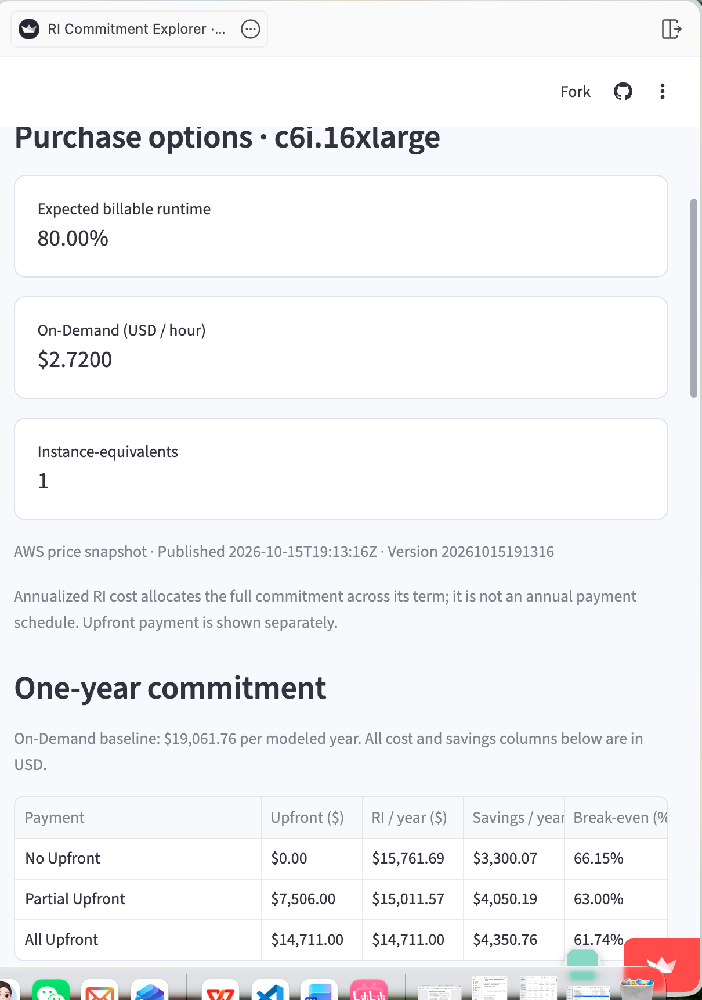

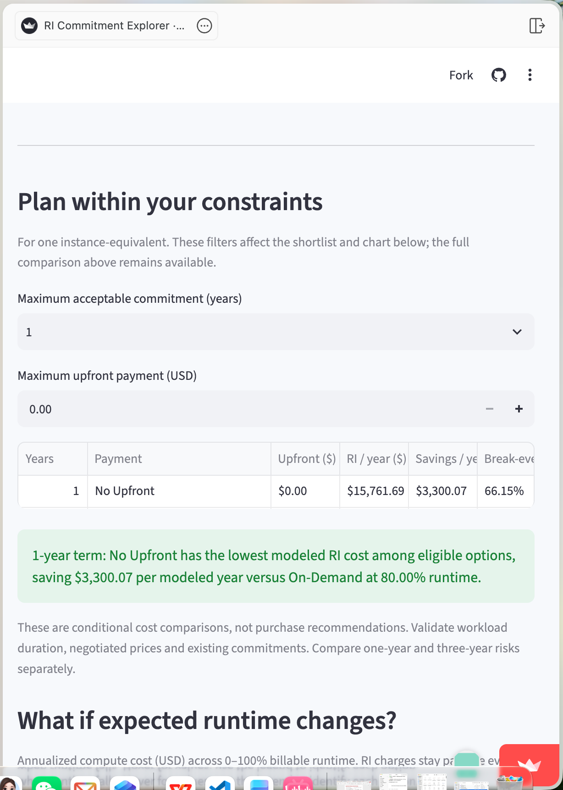

**50% lower-runtime scenario:** The same instance, maximum term and upfront limit remain
selected; only expected runtime changes to 50%.

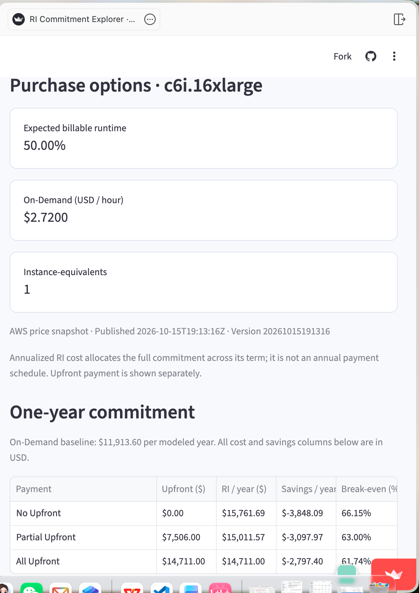


**What they see:** The public app displays the following annual costs and savings, matching
the earlier local walkthrough and the independent calculation. Modeled billable hours are
calculated here as runtime multiplied by 8,760; the app does not display that hours conversion.

| Expected billable runtime | Modeled billable hours/year | On-Demand annual cost | RI annualized cost | Annual savings vs. On-Demand |
|---|---:|---:|---:|---:|
| 80% | 7,008 | $19,061.76 | $15,761.69 | $3,300.07 |
| 50% | 4,380 | $11,913.60 | $15,761.69 | -$3,848.09 |

The supplied constrained capture shows one eligible option at 80%: one-year No Upfront, with 66.15% break-even and $3,300.07 modeled annual savings. At 50%, the supplied full-table capture shows the same RI cost of $15,761.69 and savings of -$3,848.09 against $11,913.60 On-Demand. Under the unchanged one-year/$0 constraints, this remains the eligible option because only its upfront payment is $0. This establishes the cost reversal without needing another chart capture.

The contributor's original walkthrough also described the 50% filtered warning and sensitivity chart. Those views are not pictured in the three supplied captures; the chart descriptions are contributor-reported observations rather than additional screenshot evidence. The arithmetic and visible tables suffice for the comparison in this case.

**Evidence identity:** AWS publication `2026-10-15T19:13:16Z`, version `20261015191316`;
the public page shows the same source version and $2.7200/h On-Demand rate as the independently
checked snapshot. That snapshot's selected RI rate is $1.79928/h, with $0 upfront. Local code
reference `a534478` and its later request-log-only update `972beb4` are inspection references;
the deployment's exact commit was not exposed on the page. The contributor references `screenshots/alex-live-verification.json`, which was not supplied. These records and commit references were not independently checked during integration.

#### 4. Reading the result for their decision

**Does the number measure what this person cares about?** The cost and savings figures address
Alex's narrow question: what one comparable instance-equivalent would cost under a specified
runtime assumption and purchase option. The break-even value is the share of modeled hours
needed for On-Demand cost to equal this RI's commitment cost, not a probability or a CPU
utilization target. The independent check finds 66.15%; Alex's 80% and 50% scenarios fall on
opposite sides of that threshold. The numbers do not measure total game infrastructure costs
or predict whether either runtime scenario will occur.

**Who is in the rows, and who is not?** A processed row is one public-price RI purchase option,
not a player, observed workload, or company invoice. The team's snapshot contains 54 options
across nine C6i sizes, two commitment lengths and three payment options. The app fixes
`us-east-1`, Linux, shared tenancy and other configuration attributes so prices are comparable;
Alex's shortlist further restricts the term and upfront payment. Other regions and instance
families, Savings Plans, Spot prices, and non-compute services are outside this comparison.
The snapshot contains neither Riot's actual usage nor its private pricing and existing commitments.

**What outside the data matters to this decision?** Engineering must establish whether the
capacity can actually stop running when it is unnecessary, whether the workload will continue
for a year, and whether other matching usage could use an otherwise idle commitment. Alex also
needs account-specific pricing and existing-commitment information. AWS's billing rules explain
the full-term obligation and matching-usage benefit; its recommendation documentation shows
why historical usage is relevant but does not establish a launch forecast. The model also
assumes 8,760 hours per year and constant prices and runtime within the term.

**What could they wrongly conclude from it?** Alex could read the positive 80% saving as a
guarantee that buying an RI is the right action, although the 50% scenario reverses the result.
A machine that runs continuously at low CPU usage still has 100% billable runtime; entering
its CPU percentage would answer a different question. Reading public-price scenario savings
as observed company savings is a stand-in/proxy error (handout 11.5, kind 3). Applying this
single-configuration result to the studio's whole fleet would also change which rows belong
in the decision (kind 2). The $0 upfront limit constrains the initial payment, not the total cost.

**Independent check:** The inputs below were read from the selected snapshot row above.
This calculation imports no application code. It accumulates RI charges for all committed
hours, then locates the On-Demand/RI cost crossing using hourly, minute and second increments.
Fractions preserve exact costs; Decimal is used only to format the printed values.

```python
from decimal import Decimal as D
from fractions import Fraction as F

def show(x, places=2):
    return f'{D(x.numerator) / D(x.denominator):.{places}f}'

p, h = F('2.72'), F('1.79928')
ri = sum((h for _ in range(8760)), F(0))
for runtime in (80, 50):
    od = p * F(8760 * runtime, 100)
    print(f'{runtime}%: OD={show(od)}, RI={show(ri)}, savings={show(od-ri)}')

seconds, cost = 0, F(0)
for step in (3600, 60, 1):
    increment = p * F(step, 3600)
    while seconds + step <= 8760 * 3600 and cost + increment < ri:
        seconds += step
        cost += increment

crossing = seconds + 1
assert cost < ri <= cost + p / 3600
assert cost + p / 3600 == ri
print(f'Crossing: {crossing:,} seconds; {show(F(crossing*100, 8760*3600))}% runtime')
```

```text
80%: OD=19061.76, RI=15761.69, savings=3300.07
50%: OD=11913.60, RI=15761.69, savings=-3848.09
Crossing: 20,861,064 seconds; 66.15% runtime
```

This check supports the selected option's arithmetic under shared price inputs and assumptions.
It does not independently verify raw-data filtering/pairing, other purchase options, or all
other app selections. The selected public-app results agree with it, with the same source
version and matching values for both runtime scenarios.

#### 5. The verdict: prove or break

**Verdict: prove for this specific scenario-comparison task.** The current dashboard gives
Alex the information needed to understand the runtime risk of the selected commitment. The
public-app results match the independent calculation: the option saves $3,300.07 at 80%
runtime but costs $3,848.09 more than On-Demand at 50%, with a 66.15% break-even threshold.
The eligible shortlist, positive-savings message, cost-increase warning and sensitivity chart
present this reversal clearly. No additional interface change is needed to interpret this case.

A spreadsheet could reproduce the arithmetic, but the app brings the constraints, costs,
threshold and runtime curve together without Alex having to assemble that comparison.
Cost Explorer provides account-specific historical evidence, while this app makes the two
hypothetical future-runtime scenarios explicit. Alex is therefore better informed using the
app alongside engineering's workload assessment and account-based information.

Within the available public-price data and fixed configuration, the current panel supports
this narrow task well. What remains uncertain is which runtime scenario is realistic and
whether the company's actual pricing and existing commitments change the comparison. More
arithmetic on the same price sheet would not resolve those missing facts. Alex should use
the result to discuss dependable matching usage with engineering and verify account-specific
prices before approving a commitment.

The app should not be used as an actual-bill forecast, a hardware-sizing tool, or a ranking of
all AWS purchase strategies. It cannot predict player demand or assign probabilities to the
scenarios. The conclusion supports its use for this case, rather than claiming it is the best
procurement tool for every situation. No additional change request is proposed for this case.

### 2.4 Winnie


#### 1. The person and the decision


Winnie is a cloud cost analyst at a hypothetical game studio. Engineering has approved two possible Linux EC2 instance configurations, c6i.2xlarge and c6i.4xlarge, for a planned service, and Winnie must prepare a cost comparison to decide which configuration should be included in the service's initial budget proposal. She uses the RI Commitment Explorer to compare their modeled On-Demand and Reserved Instance costs under the same expected runtime and purchasing constraints. The comparison will support a later discussion with Engineering and Finance, who will make the final infrastructure and purchasing decision; using only the modeled cost could overlook workload fit, performance and existing commitments.

#### 2. Their real situation and alternatives


Winnie currently prepares an initial budget comparison for a planned service by comparing two engineering-approved Linux EC2 configurations, c6i.2xlarge and c6i.4xlarge, under the same runtime and purchasing assumptions. Her goal is to give Engineering and Finance a clear comparison of the modeled On-Demand and Reserved Instance costs before they discuss the final infrastructure and purchasing plan. AWS explains that Reserved Instances can have one-year or three-year terms and No Upfront, Partial Upfront or All Upfront payment options, so Winnie needs to compare the total modeled cost and payment structure rather than looking only at one hourly rate [1]. 

Winnie’s alternatives are to reproduce the comparison in a spreadsheet using the published rates, consult AWS Cost Explorer for account-specific reservation recommendations, and ask Engineering to confirm that both configurations meet the service’s performance and capacity requirements. Cost Explorer can provide useful historical usage evidence, but AWS states that its reservation recommendations are based on past On-Demand usage and assume that past usage represents future usage; they do not replace Winnie’s comparison of the two approved configurations or the company’s own future-demand assessment [2]. 
**Sources:**

1. **Title:** [Reserved Instances for Amazon EC2 overview](https://docs.aws.amazon.com/AWSEC2/latest/UserGuide/ec2-reserved-instances.html)  
   **Published by:** Amazon Web Services
2. **Title:** [Accessing reservation recommendations](https://docs.aws.amazon.com/cost-management/latest/userguide/ri-recommendations.html)  
   **Published by:** Amazon Web Services

#### 3. The app in use


**Live link:** 
[RI Commitment Explorer](https://dso576-project-m10-dgvbvbjl9c4y23u6decrwc.streamlit.app/)
**What they select:**
Winnie first selects `c6i.2xlarge`, enters an expected billable runtime of 80%, sets the maximum acceptable commitment to one year, and sets the maximum upfront payment to $0. She records the modeled On-Demand
and RI costs. She then changes only the instance type to `c6i.4xlarge` and records the same values under the same constraints.

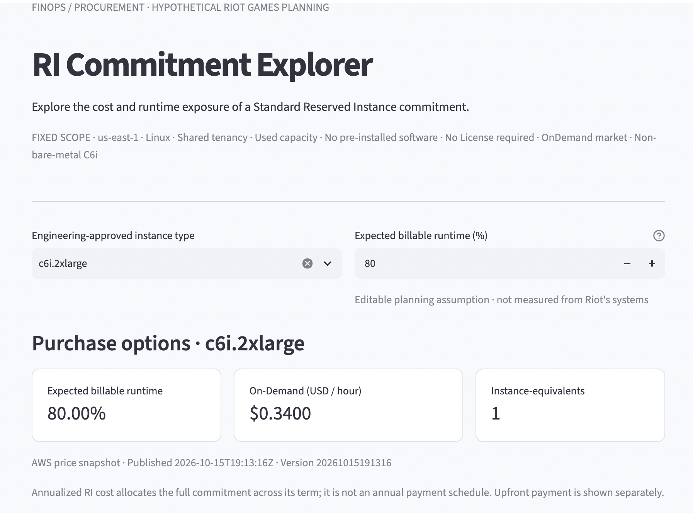
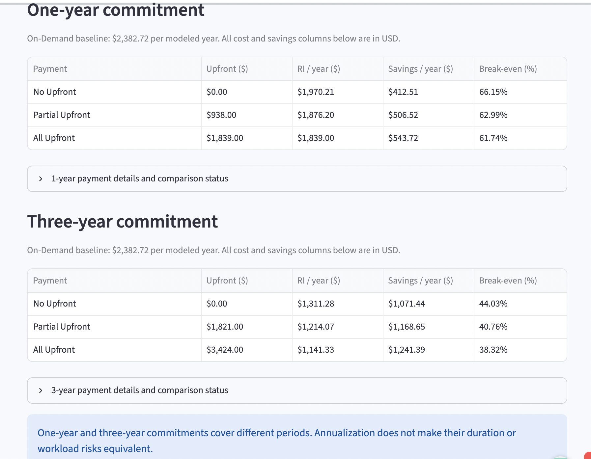
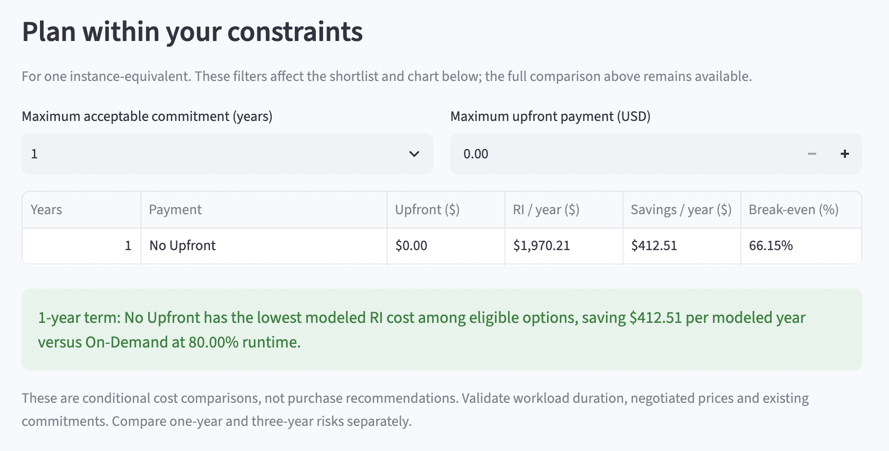
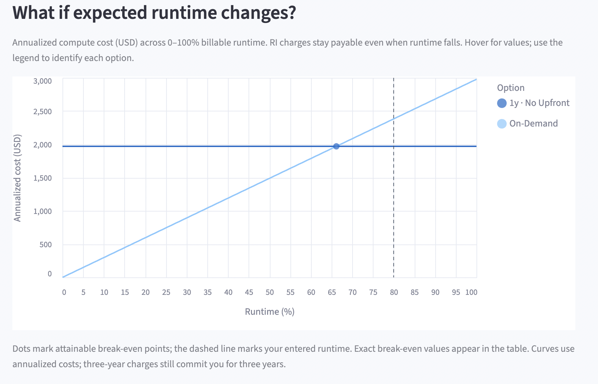
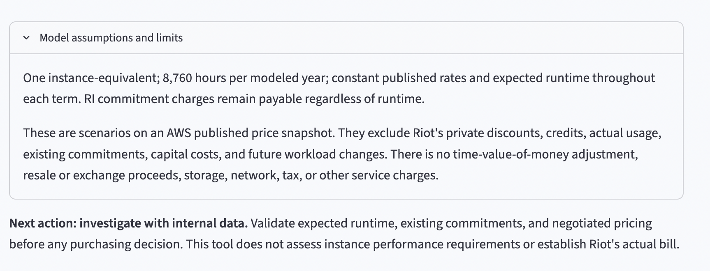
The app shows the On-Demand price, the eligible one-year RI option, the
annualized RI cost, modeled annual savings and the break-even runtime for
`c6i.2xlarge`.

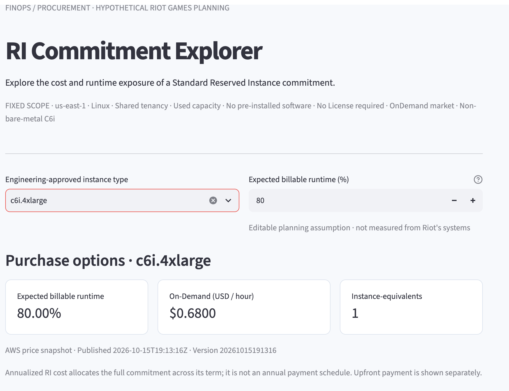
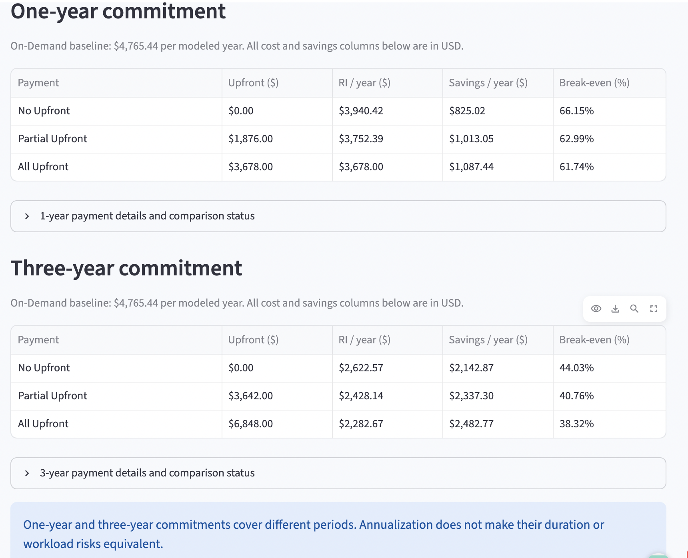
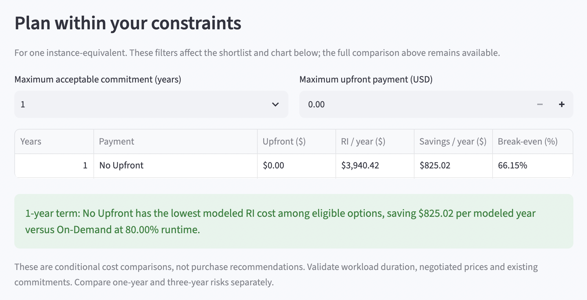
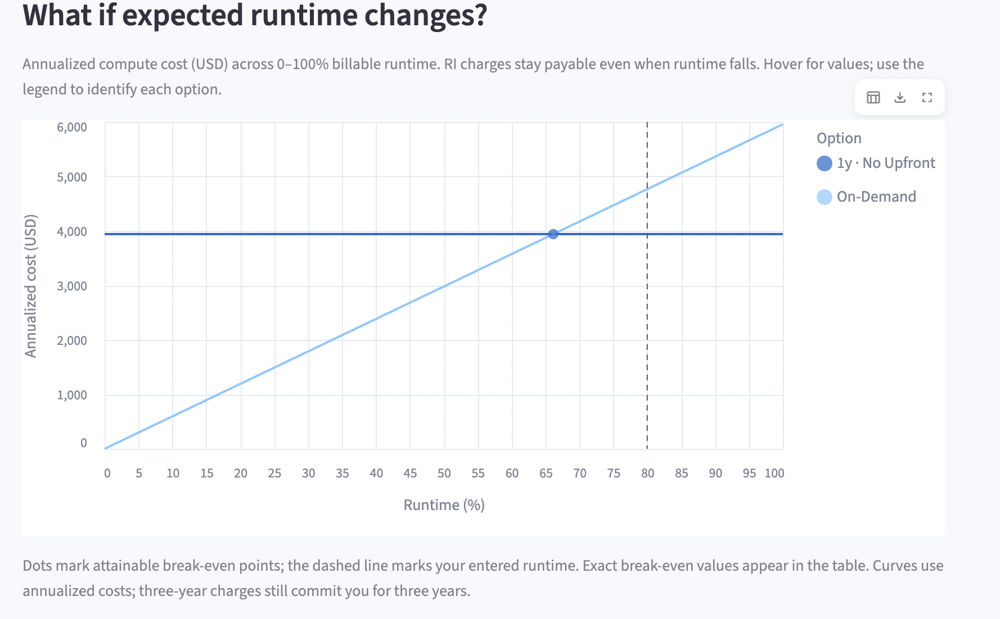
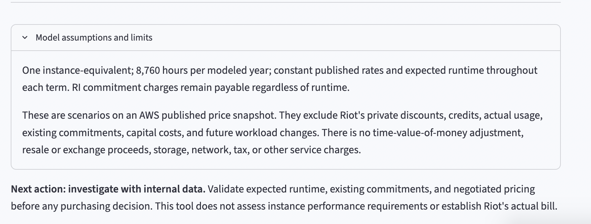
The app shows the On-Demand price, the eligible one-year RI option, the
annualized RI cost, modeled annual savings and the break-even runtime for
`c6i.4xlarge`.

**What they see:** 
For c6i.2xlarge, the app shows an 80% expected billable runtime, one instance-equivalent, and an On-Demand price of $0.3400 per hour. The modeled On-Demand baseline is $2,382.72 per year. In the full comparison, the one-year No Upfront RI costs $1,970.21 per year and shows $412.51 in modeled annual savings, with a break-even runtime of 66.15%. With a maximum one-year commitment and $0 maximum upfront payment, the eligible shortlist contains only the one-year No Upfront option. The app repeats the same result in the comparison message and shows the 80% runtime marker to the right of the break-even point on the chart.

For c6i.4xlarge, the same 80% runtime and one-instance assumption produce an On-Demand price of $0.6800 per hour and a modeled On-Demand baseline of $4,765.44 per year. The one-year No Upfront RI costs $3,940.42 per year and shows $825.02 in modeled annual savings, with the same 66.15% break-even runtime. The screenshots therefore show that c6i.4xlarge has higher modeled costs and higher modeled savings in absolute dollars than c6i.2xlarge under the same assumptions. The chart and the model-limits text also show that these are conditional cost comparisons based on one instance-equivalent, 8,760 modeled hours per year, constant published rates and runtime, and RI charges that remain payable regardless of runtime; the app does not present the result as a purchase recommendation.

#### 4. Reading the result for their decision


**Does the number measure what this person cares about?** 
The numbers measure the modeled cost difference between two engineering-approved instance configurations under the same assumptions: 80% expected billable runtime, one instance-equivalent, a one-year maximum commitment and no upfront payment. For c6i.2xlarge, the app shows an On-Demand baseline of $2,382.72 per modeled year and a one-year No Upfront RI cost of $1,970.21, producing $412.51 in modeled annual savings. For c6i.4xlarge, it shows an On-Demand baseline of $4,765.44 and a one-year No Upfront RI cost of $3,940.42, producing $825.02 in modeled annual savings.

These numbers answer Winnie’s narrow question about the public-price cost difference between the two configurations. They do not answer which configuration has better performance, capacity or workload fit. The annual savings are also modeled savings rather than observed company savings. The app’s runtime chart shows a break-even point of 66.15% for the one-year No Upfront option; this is a cost threshold, not a probability or a performance target.

**Who is in the rows, and who is not?** 
Each row in the app’s table represents one public-price RI payment option for one selected instance-equivalent. The rows are not employees, servers observed in the company, invoices or actual workload records. The one-year table contains No Upfront, Partial Upfront and All Upfront options, while the constraint filter leaves only the one-year No Upfront option eligible because the maximum upfront payment is $0.

The comparison between c6i.2xlarge and c6i.4xlarge comes from two separate app selections, not from a single row containing both configurations. The tables do not include other regions, instance families, services, negotiated prices, existing commitments, fleet-wide usage or performance measurements. Therefore, Winnie cannot treat the lower modeled cost as proof that one configuration is technically better for the service.

**What outside the data matters to this decision?** 
Engineering must confirm whether both configurations meet the planned service’s performance, memory, networking and capacity requirements. Winnie and Finance must also check the expected future demand, actual billable runtime, existing RIs or Savings Plans, private or negotiated prices, credits, taxes and internal budget rules. The app uses a public AWS price snapshot and an editable runtime assumption; it does not contain the studio’s private account information.

AWS Cost Explorer can provide account-specific historical usage and reservation recommendations, but AWS states that these recommendations use past On-Demand usage and assume that past usage represents future usage. This is useful evidence but does not replace Engineering’s future workload assessment. AWS also explains the RI terms and payment options in its Reserved Instances for Amazon EC2 overview, while the app provides the focused comparison between the two selected configurations.

**What could they wrongly conclude from it?** 
Winnie could conclude that c6i.4xlarge is automatically the better choice because its modeled annual savings of $825.02 are larger than the $412.51 shown for c6i.2xlarge. That would be wrong because the larger instance also has a higher On-Demand and RI cost, and the app does not show whether its additional capacity is needed.

She could also treat the 80% input as a measured utilization rate, although the app labels it as an editable planning assumption. She could read the savings as guaranteed company savings, even though the calculation uses public prices and does not include existing commitments or negotiated rates. Finally, she could interpret the green comparison message as a purchase recommendation, although the app explicitly states that the results are conditional cost comparisons and not purchase recommendations.

Independent displayed-value reconciliation (uses displayed annual RI costs, so it does not independently validate source rates or RI annualization): 
```python
from decimal import Decimal as D

hours = D("8760")
runtime = D("0.80")

cases = [
    ("c6i.2xlarge", D("0.3400"), D("1970.21")),
    ("c6i.4xlarge", D("0.6800"), D("3940.42")),
]

for instance, ondemand_rate, ri_cost in cases:
    ondemand = ondemand_rate * hours * runtime
    savings = ondemand - ri_cost
    breakeven = ri_cost / (ondemand_rate * hours) * 100
    print(instance)
    print(f"On-Demand={ondemand:.2f}")
    print(f"Savings={savings:.2f}")
    print(f"Break-even={breakeven:.2f}%")
```
Expected output:
```text
c6i.2xlarge
On-Demand=2382.72
Savings=412.51
Break-even=66.15%

c6i.4xlarge
On-Demand=4765.44
Savings=825.02
Break-even=66.15%
```

#### 5. The verdict: prove or break


**Verdict: prove for Winnie's narrow cost-comparison task.** 
Winnie is better off using the RI Commitment Explorer as the first step in her budget proposal because it gives her a consistent, visible comparison of the two engineering-approved configurations under identical assumptions. The app shows that `c6i.2xlarge` has a modeled On-Demand baseline of `$2,382.72` and a one-year No Upfront RI cost of `$1,970.21`, while `c6i.4xlarge` has a modeled On-Demand baseline of `$4,765.44` and a one-year No Upfront RI cost of `$3,940.42`. The independent arithmetic check reproduces the displayed savings of `$412.51` and `$825.02`, and the screenshots show the same runtime, commitment limit and upfront limit for both configurations.

The app is more useful for this first comparison than a spreadsheet because the selected inputs, source snapshot, full payment tables, constraints, break-even value and runtime chart appear together in one reproducible workflow. A spreadsheet could reproduce the arithmetic, but Winnie would need to build and maintain the formulas herself. AWS Cost Explorer can add account-specific historical usage and reservation recommendations, while Engineering can verify performance and capacity; neither alternative directly provides the same focused comparison of these two hypothetical approved configurations under the chosen assumptions. The app therefore belongs at the beginning of the workflow, alongside those alternatives, rather than replacing them.

Winnie must not use the app as a hardware-sizing tool, a performance test, a forecast of the studio's actual bill, or a final purchase recommendation. The `80%` runtime is an editable planning assumption, the prices are public snapshot values, and the app does not include existing commitments, negotiated prices, credits, future demand or technical requirements. The result supports the budget discussion by showing the modeled cost difference; Engineering and Finance must still decide whether either configuration is suitable and what the company should ultimately purchase.

For this specific task, no change request is necessary. The app already lets Winnie change the instance type and runtime, keeps the one-year and zero-upfront constraints visible, compares the eligible option with On-Demand, shows the break-even point and warns that the result is a conditional cost comparison rather than a purchase recommendation. The missing information is company-specific evidence that must come from Engineering, Finance and account data, not additional arithmetic from the same public price table.

### 2.5 Casey


**Decision memo | RI Commitment Explorer | Live check: 7 November 2026**

**Keep the existing coverage and decline the overlapping purchase under the assumptions below.** The app correctly shows $252.03 of annual savings against uncovered On-Demand usage. For Casey's already-covered workload, however, buying another RI adds $492.57 of one-year compute commitment. Use the app for public-price comparisons; establish existing coverage before using its results in a purchase decision.

#### 1. The person and the decision

Casey is a fictional FinOps analyst at a game studio, reviewing a ticket to buy a one-year No Upfront Reserved Instance (RI). Engineering has approved one c6i.large workload. Before approving the ticket, Casey must establish whether another commitment reduces future costs or simply overlaps coverage already purchased.

This is a hypothetical decision case grounded in AWS billing rules and an observed public-app run, not evidence about any real customer's systems or bill.

#### 2. Their real situation and alternatives

Assume one Linux, shared-tenancy c6i.large in us-east-1 runs for the next 8,760 hours. A matching All Upfront RI, paid before this decision, already covers that entire horizon. No other eligible workload can use another reservation; neither alternative includes resale, exchange or reassignment. New purchases may commit for at most one year and require $0 upfront.

AWS explains that RIs provide billing discounts for matching usage. All Upfront requires payment at the start; No Upfront requires hourly payments throughout the commitment, regardless of use [1]. Discounts apply automatically to eligible running instances [2]. These rules make prior coverage essential to this decision.

Casey can use the app to screen published prices, or use AWS Cost Explorer coverage/utilization reports and reservation inventory to establish the account's position. AWS documents that these reports show covered usage and unused commitments [3]. The billing owner must also confirm matching attributes and expiry dates. Account evidence is more useful than a public-price table for deciding whether another reservation is needed.

#### 3. The app in use

**Official live app:** [RI Commitment Explorer](https://dso576-project-m10-dgvbvbjl9c4y23u6decrwc.streamlit.app/).

In Edge, select **c6i.large**, **100% expected billable runtime**, **1-year maximum commitment**, and **$0 maximum upfront payment**. The page identifies snapshot **20261015191316**, published 15 October 2026. Figures below are observations from this snapshot, not a current AWS price quote.

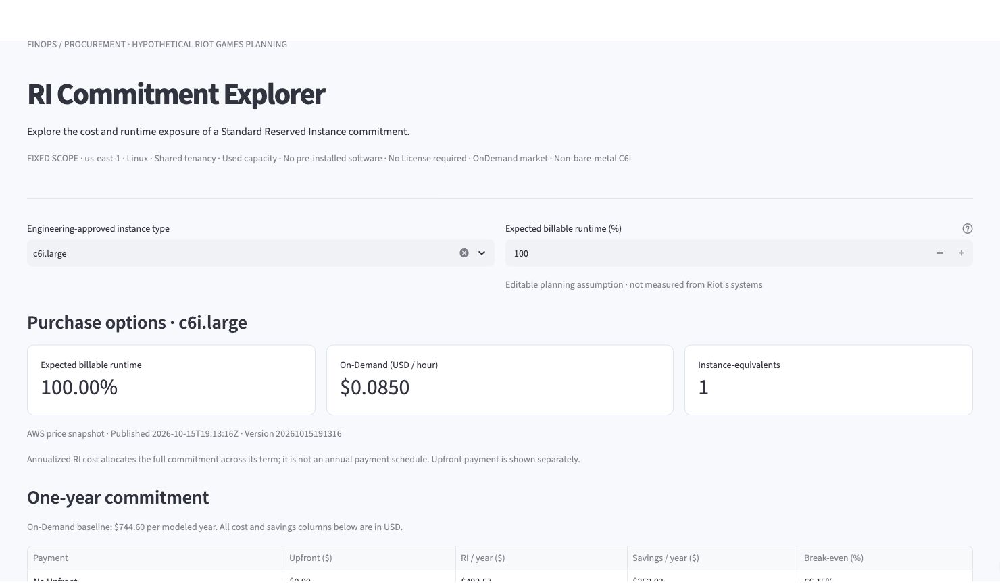

The eligible shortlist contains one option: **1-year No Upfront**, costing **$492.57/year**, saving **$252.03/year** against **$744.60/year** On-Demand. Break-even runtime is **66.15%**. The result caption explicitly calls this a conditional comparison and asks users to validate existing commitments.

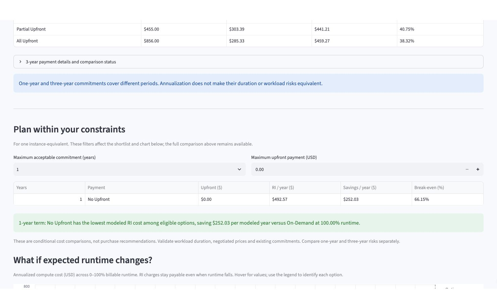

#### 4. Reading the result for their decision

**The number versus the decision.** The app measures savings against an uncovered On-Demand baseline. Casey needs the incremental future cost of buying versus retaining coverage. This is Module 11's kind 3: a stand-in for the real decision quantity. The calculation can be correct while its purchasing interpretation is wrong.

**Who is in the rows?** The selected table row is a published price option for one instance type, term and payment method. It is not an observed workload or an account's reservation inventory. The app's assumptions panel explicitly excludes existing commitments and actual usage. It uses one instance-equivalent and 8,760 hours per modeled year.

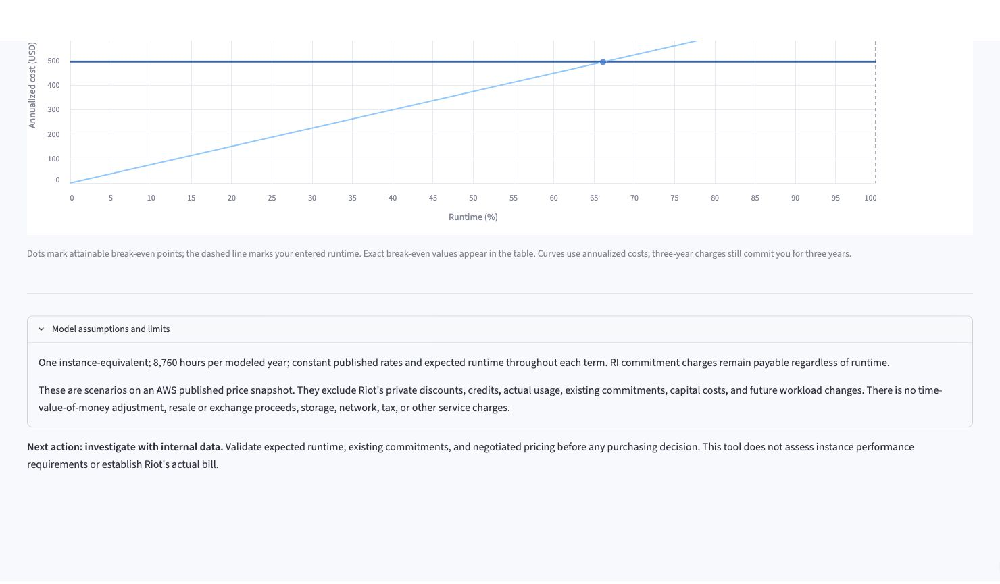

**What outside the data matters?** Remaining reservation term, matching attributes, effective coverage and other eligible workloads determine whether the new commitment has value. If coverage expires early or another workload can consume the benefit, this case must be recalculated. The earlier upfront payment is common to both paths; excluding it from incremental cash costs does not mean the existing RI was free. Storage, networking, taxes and other common charges are outside this comparison.

**Possible misreading:** “The green $252.03 savings means this ticket will reduce our bill.” The app does not establish that. Under this case's assumptions, the new RI eliminates no uncovered usage.

| Comparison over 8,760 hours | Keep current path | Buy additional RI | Saving from buying |
|---|---:|---:|---:|
| App's uncovered On-Demand baseline | $744.60 | $492.57 | $252.03 |
| Casey's fully covered usage: additional compute commitment | $0.00 | $492.57 | -$492.57 |

The second row is a scenario inference from the assumptions and billing rules, not an additional app output or measured account result.

Contributor-reported independent check (the referenced `verify_case.py` was not included in this package; the arithmetic is also reproduced in Section 3.5):

```text
uv run python cases/case-casey-existing-coverage/verify_case.py
On-Demand: 0.085 * 8760 = 744.6000
New RI:   0.05623 * 8760 = 492.5748
Saving against On-Demand: 252.0252
Incremental saving for Casey: 0 - 492.5748 = -492.5748
PASS: four independent arithmetic assertions
```

#### 5. The verdict: prove or break

The app is useful as a price-screening companion, but account coverage reports are necessary for Casey's approval decision. Its calculation holds up; its scope stops short of an account-specific purchase recommendation. Casey should decline the overlapping RI under the stated assumptions.

**Open change request CR-02 (synchronized to `change-requests.md`):** add a coverage checkpoint beside the eligible-results summary: “Is this future usage uncovered by existing commitments?” with **Uncovered / Covered / Not checked**. For Covered or Not checked, prominently state that displayed savings assume uncovered On-Demand usage and direct the user to verify coverage and expiry. The app already has a caveat; this makes the caveat an explicit step in the decision flow.

Keep the existing cost table unchanged for all three answers. The change would help other FinOps users reviewing existing fleets without altering the monetary results of runtime, budget, term or sizing cases. Acceptance: all three answers preserve the table; Covered/Not checked display the baseline warning; no choice becomes a purchase recommendation. This is a proposed improvement, not an implemented feature.

**Sources (AWS; accessed 7 November 2026)**

1. [Reserved Instances for Amazon EC2 overview](https://docs.aws.amazon.com/AWSEC2/latest/UserGuide/ec2-reserved-instances.html): matching usage and All/No Upfront payment obligations.
2. [How Reserved Instance discounts are applied](https://docs.aws.amazon.com/AWSEC2/latest/UserGuide/apply_ri.html): automatic application to eligible instance usage.
3. [Using the default Cost Explorer reports](https://docs.aws.amazon.com/cost-management/latest/userguide/ce-default-reports.html): coverage and utilization reports as account-specific alternatives.

### 2.6 Maya


**App:** RI Commitment Explorer  
**Prepared:** November 7, 2026  
**Decision in brief.** For the assumed project, investigate a one-year All Upfront RI followed by six modeled months of On-Demand, rather than choosing a three-year RI from its lower annualized price. At the recorded public prices, those strategies create modeled costs of **$832.30** and **$856.00**, respectively. The app supplies the price comparison and warns about unequal terms, but it does not directly calculate this project's 18-month horizon. This is a conditional shortlist, not an actual purchase recommendation.

#### 1. The person and the decision

Maya is a fictional engineering delivery lead at a hypothetical game studio. She is planning the retirement of a legacy telemetry service after an **18-month migration**. Engineering has already approved one Linux `c6i.large` instance-equivalent in `us-east-1`. It must run continuously until retirement. Maya and FinOps must decide whether to investigate a one-year RI with an On-Demand remainder, a three-year RI, or On-Demand throughout.

The person, migration plan, approved configuration and retirement date are **case assumptions**, not facts about Riot Games or a real employee. Assume no existing commitment covers this demand, no other workload can absorb the reservation after retirement, and sufficient upfront funds are available. Runtime stays at **100% while the project exists**. The decision concerns **commitment length versus remaining project life**; it does not vary runtime as Alex's case does or impose Jordan's upfront-budget constraint.

#### 2. Their real situation and alternatives

An engineering lead contributes future resource plans to commitment decisions. The FinOps Foundation's [Rate Optimization guidance](https://www.finops.org/framework/capabilities/rate-optimization/) assigns Engineering responsibility for communicating significant usage changes and calls for commitment terms to fit infrastructure lifecycles. This supports investigating a planned retirement before buying a long contract; it does not establish this fictional studio's migration schedule.

[AWS's RI documentation](https://docs.aws.amazon.com/AWSEC2/latest/UserGuide/ec2-reserved-instances.html) explains that RIs are billing discounts, have one- or three-year terms, and cannot simply be canceled after purchase. Upfront and recurring components must be counted across the full obligation. [AWS's On-Demand documentation](https://docs.aws.amazon.com/AWSEC2/latest/UserGuide/ec2-on-demand-instances.html) establishes the alternative without a long-term commitment. Together, these sources support comparing a bounded project with a shorter commitment and an On-Demand remainder.

Without this app, Maya and FinOps can use AWS's published rates in a spreadsheet, then validate the project schedule and account coverage with internal engineering and billing records. That remains necessary: neither a price table nor a cheaper annualized rate establishes future demand. Savings Plans, eligible Marketplace reservations and other products may also merit investigation; this case does not rank them. [AWS's Marketplace rules](https://docs.aws.amazon.com/AWSEC2/latest/UserGuide/ri-market-general.html) allow some Standard RI resales under conditions, but ownership continues until a sale. A listing is not an assumed exit or a guaranteed recovery value here.

#### 3. The app in use

**Live app:** [RI Commitment Explorer](https://dso576-project-m10-dgvbvbjl9c4y23u6decrwc.streamlit.app/)

The contributor reports opening the public deployment in a fresh temporary browser profile without a sign-in. Three supplied screenshots are included below. The referenced `live-evidence.json` was not supplied; anonymous access was not independently retested during integration.

| Setting | Selected value |
|---|---|
| Engineering-approved instance | `c6i.large` |
| Expected billable runtime | `100%` while operating |
| Quantity | One instance-equivalent |
| Maximum acceptable commitment | `3 years`, to inspect both terms |
| Maximum upfront payment | `$856`, admitting every displayed option for this instance |
| Project horizon | 18 modeled months; an external assumption, **not an app input** |

The display identifies snapshot **20261015191316**, published **2026-10-15T19:13:16Z**. On-Demand is **$0.0850/hour**, or **$744.60 per modeled year** at the entered runtime. The relevant All Upfront rows show:

| Term | Upfront payment / full obligation | Annualized RI cost | Displayed annual savings versus On-Demand |
|---|---:|---:|---:|
| One year | $460.00 | $460.00 | $284.60 |
| Three years | $856.00 | $285.33 | $459.27 |

**Figure 1.** The live configuration and both complete term tables. The three-year option has the smaller annualized cost, while its upfront/full-term amount is larger.

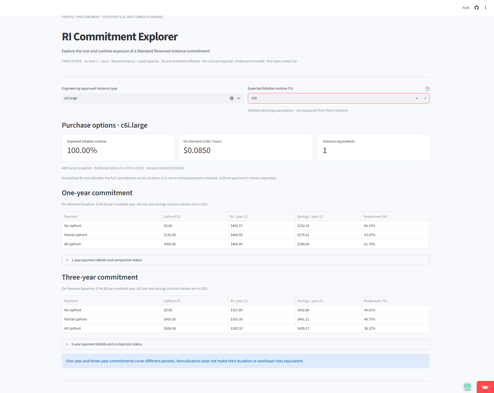

**Figure 2.** Maximum term three years and upfront cap $856 retain all six RI options. The app reports a lowest-cost payment option **within each term**; it does not report the lowest total for an 18-month project.

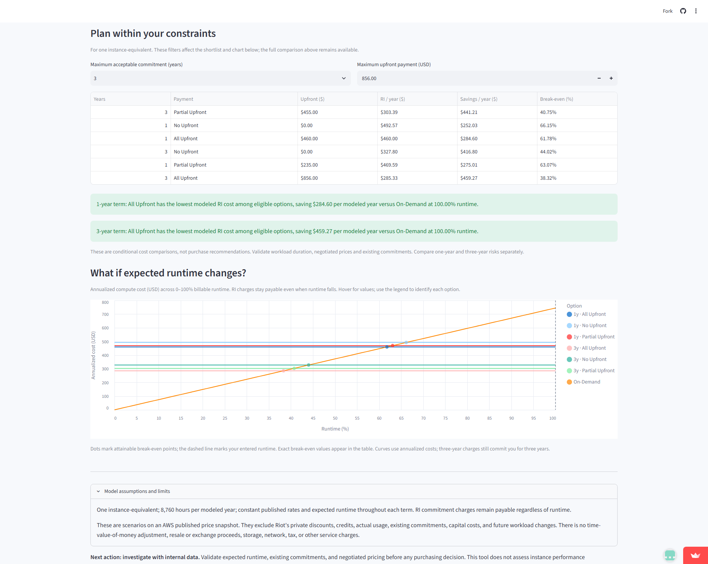

**Figure 3.** The app's assumptions say that runtime and prices remain constant throughout each term and that future workload changes are excluded. This boundary matters for a project that ends before a three-year commitment does.

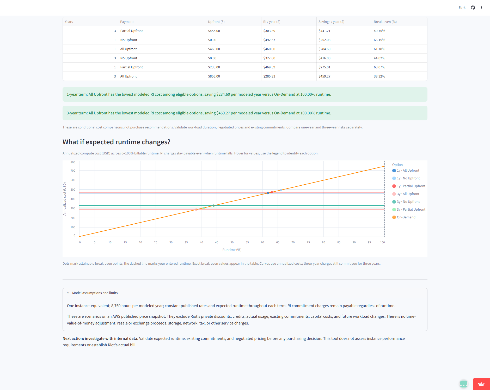

##### Independent calculation for the project horizon

The app uses 8,760 hours per modeled year. To remain consistent, **18 modeled months means 1.5 modeled years, or 13,140 hours**; six modeled months is 4,380 hours. These are modeling conventions, not a calendar-specific forecast.

The contributor describes a separate `verify_case.py` script (not supplied in this package) that reads the recorded upfront and recurring payment components, uses Decimal arithmetic, and **does not import the app's calculation functions**. It charges every RI for its complete term. A one-year reservation is followed by 4,380 On-Demand hours; a three-year reservation retains its entire obligation even though the project ends earlier.

```text
On-Demand for the whole project:
  0.085 × 13,140                         = $1,116.90
One-year All Upfront, then On-Demand:
  460 + 0.085 × 4,380                   =   $832.30
Three-year All Upfront, full obligation:
  856 + 0 × 26,280                      =   $856.00
Difference between the two RI strategies =    $23.70
```

For completeness, the same script checks all six RI options using this rule:

| Strategy | Modeled cost including all resulting RI obligations |
|---|---:|
| One-year All Upfront + six modeled months On-Demand | $832.30 |
| One-year Partial Upfront + six modeled months On-Demand | $841.89 |
| Three-year All Upfront, entire contract | $856.00 |
| One-year No Upfront + six modeled months On-Demand | $864.87 |
| Three-year Partial Upfront, entire contract | $910.17 |
| Three-year No Upfront, entire contract | $983.40 |
| On-Demand throughout | $1,116.90 |

This identifies the minimum **among these seven specified strategies**. It is not an exhaustive optimization across every AWS product, purchase date, resale or portfolio-sharing arrangement. The source inputs come from the repository's processed snapshot; the independent check verifies arithmetic, not the full raw-data pipeline or whether prices will remain available.

#### 4. Reading the result for their decision

**Does the number measure what Maya cares about?** The app correctly defines annualized cost, but Maya needs the cost and obligation created by serving a finite project. In `src/scenario.py`, full RI cost is upfront payment plus recurring rate times term hours; the annualized output divides this by term years. In `src/views.py`, the app explicitly warns that annualization does not make different durations equivalent. Her comparison must therefore restore the full obligation and add uncovered project hours. The calculations above do this outside the app.

This is a **kind 5, which dates belong** issue: 18 months of demand do not establish 36 months of matching demand. It also presents a **kind 4, total versus rate** risk. Multiplying the unrounded three-year annualized price by 1.5 would yield $428, but that is an allocation, not the $856 contractual cost. Maya cannot terminate half the obligation by retiring the service halfway through the term. Her 100% input describes continuous operation while the project exists; it is not evidence of continuous operation throughout every contract shown.

**Who is in the rows, and who is not?** A row is a published purchase option, not a measured server, employee or migration outcome. The live tables show six RI options for the chosen instance within the app's Linux, shared-tenancy C6i scope in `us-east-1`. They contain no project retirement date, future workload inventory, account-specific coverage or measured performance. Maya cannot infer that another workload will use the remaining commitment from these rows.

**What outside the data matters?** The migration may finish early, run late or change configuration. Other workloads might legitimately use matching RI benefits; that would change the no-reuse assumption and could change the comparison. Actual negotiated prices, existing commitments and the cost of prepayment also matter. Future On-Demand prices are unknown: $832.30 assumes the recorded rate continues during the final six modeled months. The $23.70 difference is narrow, not evidence that the shorter strategy wins under every plausible business condition. No resale value, financing adjustment or guaranteed exit is assumed.

**What could Maya wrongly conclude?** The three-year row's $459.27 annual savings does not mean that this project will realize that saving for three years. Nor does a 100% runtime input validate a three-year service life. The app's separate summaries and duration warning help, but Maya must still connect those limitations to her project's end date. This case shows a mismatch between the user's horizon and a model assumption, not an arithmetic defect in the app.

#### 5. The verdict: prove or break

**Verdict: useful price evidence, incomplete support for this finite-project decision.** Under the stated assumptions, investigate a one-year All Upfront RI followed by On-Demand for the remaining six modeled months. Its $832.30 modeled cost is $23.70 below the full $856 three-year All Upfront obligation and is the lowest of the seven strategies checked. Before advancing it, validate the retirement schedule, coverage, actual prices and funding with the appropriate internal reviewers.

Compared with manually assembling published rates, the app provides an auditable starting point with visible source identity and separate term comparisons. A spreadsheet still supplies the missing project-horizon calculation. There is no user study establishing that this workflow is faster or produces better real purchases. Do not use the app's annualized ranking as the final project budget or a justification to buy a long contract without demand evidence.

The proposed improvement is to make a **finite-workload comparison** available alongside the existing constant-runtime view: accept a horizon, show full commitment obligations including charges after the workload ends, and include an On-Demand remainder when a shorter RI expires before the project does. Retain the current tables and show assumptions about continued prices and reuse explicitly. This supports migrations, retirements and other bounded projects without changing Alex's runtime scenario or Jordan's budget filter. This proposal is now recorded as **open CR-03** in the accompanying `change-requests.md`; it has not been implemented. The previously referenced `proposed-change-request.md` was not supplied.

##### Sources and reproducibility

Official sources reviewed November 7, 2026. The quotes identify the supporting text; the fictional project assumptions are not sourced facts.

1. **FinOps Foundation**, [Rate Optimization](https://www.finops.org/framework/capabilities/rate-optimization/). Supporting phrase: “Hybrid purchasing strategy that Aligns commitment terms with infrastructure usage patterns, characteristics, and lifecycle”. Supports lifecycle alignment and engineering input.
2. **Amazon Web Services**, [Reserved Instances for Amazon EC2 overview](https://docs.aws.amazon.com/AWSEC2/latest/UserGuide/ec2-reserved-instances.html). Supporting sentence: “After you purchase a Reserved Instance, you cannot cancel your purchase.” Supports term/obligation review; the same page defines the payment options.
3. **Amazon Web Services**, [Purchasing On-Demand Instances for Amazon EC2](https://docs.aws.amazon.com/AWSEC2/latest/UserGuide/ec2-on-demand-instances.html). Supporting sentence: “There is no long-term commitment required when you purchase On-Demand Instances.” Supports the uncommitted remainder alternative.
4. **Amazon Web Services**, [Sell Reserved Instances for Amazon EC2 in the Reserved Instance Marketplace](https://docs.aws.amazon.com/AWSEC2/latest/UserGuide/ri-market-general.html). Supporting sentence: “You own your Reserved Instance until it's sold.” Supports excluding an assumed automatic exit.

The contributor references repository `7206a34`, `verify_case.py`, `calculation-output.txt`, `calculation-results.json` and `live-evidence.json`. Those supporting files were not supplied, so their contents, recorded hash and commit are not independently verified here. Section 3.5 provides an executed scalar check of the stated arithmetic. Matching displayed amounts and source metadata does not independently identify the deployed commit or authenticate the full raw-to-processed pipeline.

## 3. Numbers

### 3.1 Definitions: exactly what each number means

Let `H = 8,760` modeled hours/year, `Y` be 1 or 3 years, `u` be a finite runtime fraction in [0,1], `p` be the matching On-Demand USD/hour rate, `h` the recurring RI USD/hour rate and `F` the RI upfront charge in USD. Every result is for **one instance-equivalent** with constant rates and runtime throughout the modeled term.

| Displayed measure | Precise definition and unit | Correctness criterion |
|---|---|---|
| Expected billable runtime | `100 × u`, percent of modeled hours capacity is required | Entered assumption in 0-100%; not CPU load or observed commitment utilization |
| Matching On-Demand rate | `p`, USD per billable hour | Matching product configuration and snapshot; positive finite rate |
| Upfront payment | `F`, USD at the start | Separate from recurring charges; budget eligibility is inclusive (`F <= budget`) |
| Recurring RI rate | `h`, USD per commitment hour | Charged across the full modeled term regardless of runtime |
| Total RI commitment | `C = F + h × H × Y`, USD | Must include upfront plus all commitment hours; derived check, not a claim that the app displays a total-payment schedule |
| Effective RI hourly rate | `C / (H × Y)`, USD per commitment hour | Includes allocated upfront payment; not cost divided by hours actually used |
| Annualized RI cost | `A = C / Y`, USD per modeled year | Straight-line allocation over the term, not an annual cash-payment schedule |
| On-Demand annual cost | `O = p × H × u`, USD per modeled year | Scales with required billable hours |
| Annual savings vs OD | `S = O - A`, USD per modeled year | Positive/zero/negative means lower/equal/higher modeled RI cost |
| Break-even runtime | `b = A / (p × H)`, displayed as percent | A threshold, not a forecast; do not clamp values above 100% |
| Comparison status | Sign of the unrounded `S` | Must agree with computed savings, even if displayed currency rounds near zero |
| Lowest-cost eligible RI | Minimum `A` within each allowed term after budget filtering | Preserve ties; no global claim across products or commitment risks |

`src/scenario.py` calculates financial measures with Decimal precision 28. `src/views.py` formats display values. The stored effective rate is display-only and does not drive the main scenario calculations; source correctness of that stored field must therefore be assessed separately. Showing a value with fewer decimals is presentation, not evidence that the original rate changed.

### 3.2 Data provenance and the snapshot mismatch

The supplied processed report records **54 candidate RI groups, 54 accepted and zero rejected**, across nine C6i instance types. There is one option per instance/term/payment combination: 9 × 2 × 3 = 54. The runtime file is `data/processed/c6i_price_options.parquet`; the app reads it rather than a random sample or a raw CSV at startup. For `c6i.large`, six RI options are shown in the original comparison, and one passes a one-year/$0 constraint (Casey); Jordan's $300 cap instead admits two one-year options.

The screenshots show app version metadata `20261015191316`, published `2026-10-15T19:13:16Z`. The separate uploaded dataset archive contains an EC2 raw file published `2026-09-04T23:11:17Z`, version `20260904231117`. These are **different snapshots**. A standard-library CSV scan of the September file found the selected product's full-precision rates below; they agree with the October figures visible in the screenshots, but that is not an independent end-to-end validation of the October preparation pipeline.

The independent raw selection held the configuration fixed: Compute Instance, `us-east-1`, Linux, Shared, Used capacity, no preinstalled software, no license requirement, OnDemand market field, `c6i.large`, and Standard RI or On-Demand term type. The identified SKU was `G34GXEYC28NK97K3`. On-Demand term `JRTCKXETXF` is $0.0850000000/hour; one-year No Upfront term `4NA7Y494T4` is $0.0562300000/hour. Upfront and hourly components of the other RI terms were read separately. No random sample was used for this check.

### 3.3 Independent arithmetic and results

The following reference uses scalar Decimal arithmetic without importing the app's calculation function or pandas. Its rates were separately read from the supplied September raw file; online comparison values are taken from the supplied October-snapshot screenshots. This checks the displayed cost relationships and rounding at those inputs, rather than authenticating the complete October source.

```python
from decimal import Decimal as D

hours, od_rate = D('8760'), D('0.085')
options = [
    (1, 'No Upfront', '0', '0.05623'),
    (1, 'Partial Upfront', '235', '0.02678'),
    (1, 'All Upfront', '460', '0'),
    (3, 'No Upfront', '0', '0.03742'),
    (3, 'Partial Upfront', '455', '0.01732'),
    (3, 'All Upfront', '856', '0'),
]
for years, payment, upfront, hourly in options:
    total = D(upfront) + D(hourly) * hours * years
    annual = total / years
    od = od_rate * hours * D('0.8')
    break_even = annual / (od_rate * hours)
    print(years, payment, f'RI={annual:.2f}',
          f'savings={od-annual:.2f}', f'break-even={break_even:.2%}')
```

Executed reference output at 80%:

```text
1 No Upfront RI=492.57 savings=103.11 break-even=66.15%
1 Partial Upfront RI=469.59 savings=126.09 break-even=63.07%
1 All Upfront RI=460.00 savings=135.68 break-even=61.78%
3 No Upfront RI=327.80 savings=267.88 break-even=44.02%
3 Partial Upfront RI=303.39 savings=292.29 break-even=40.75%
3 All Upfront RI=285.33 savings=310.35 break-even=38.32%
```

| Check | Independent result | Supplied online observation | Assessment |
|---|---|---|---|
| On-Demand, c6i.large, 80% | $595.68/year | $595.68 | Agrees to displayed cents |
| One-year No Upfront, 80% | $492.57/year; $103.11 savings; 66.15% break-even | Archived c6i.large 80% capture (linked below) | Agrees |
| Other one-year options, 80% | Partial $469.59/$126.09/63.07%; All $460.00/$135.68/61.78% | Previously supplied online one-year comparison; not reproduced here | Agrees |
| Three-year options, 80% | No $327.80/$267.88/44.02%; Partial $303.39/$292.29/40.75%; All $285.33/$310.35/38.32% | Additional supplied online three-year screenshot | Agrees; screenshot retained with this draft's evidence |
| On-Demand, 50% | $372.30/year | Archived c6i.large 50% capture (linked below) | Agrees |
| One-year No Upfront, 50% | $492.57/year; -$120.27 savings | Archived c6i.large 50% captures | Agrees; same break-even threshold |
| One-year/$0 eligibility | One option: No Upfront | Archived constraint captures | Agrees at both runtime settings |

At 80%, the No Upfront one-year values before display rounding are RI cost $492.57480 and savings $103.10520. At 50%, savings are -$120.27480. The full-precision threshold is 66.15294117647...%. Displaying it as 66.15% is rounding, not an exact equality at that entered percentage. For three-year All Upfront, $856/3 = $285.3333... per year; the full obligation is still $856 over three modeled years.

**Resolved rounding difference:** the rate shown as $0.0562/hour is a compact display of $0.05623. Recomputing 8,760 × 0.0562 gives $492.312, while the full rate gives $492.57480. The apparent $0.26 annual difference is explained by rounding the input too early; the app's displayed annual result matches full-precision arithmetic. Similarly, sum or difference checks should use unrounded values and round once at display time.

### 3.4 What this does and does not validate

The checks support the cost formulas, their units, six selected payment/term outputs, eligibility and the reversal at the two case assumptions. They do not validate every one of the 54 prices against the October raw data, negotiated marginal costs, actual savings or a forecast. The September raw corroboration must not be relabeled as October source reconciliation. The optional full-snapshot integration test was skipped in the reported run, as explained in Section 4. A complete October source reconstruction would require the matching raw snapshot and successful reconciliation without replacing it with September data.

### 3.5 Cross-case arithmetic and evidence limits

The following standalone scalar check was executed during integration without importing application code. Alex and Casey use the full-precision rates stated in their submitted cases. Winnie's reconciliation starts from displayed annual RI totals, so it checks subtraction and the displayed threshold rather than independently validating RI annualization or source rates.

```python
from decimal import Decimal as D
H = D('8760')
for label, p, ri in [('Alex', D('2.72'), D('1.79928')*H),
                     ('Winnie 2x', D('.34'), D('1970.21')),
                     ('Winnie 4x', D('.68'), D('3940.42'))]:
    for u in ([D('.8'), D('.5')] if label == 'Alex' else [D('.8')]):
        od = D(p)*H*u
        print(label, u, f'OD={od:.2f}', f'RI={ri:.2f}', f'S={od-ri:.2f}')
new = D('.05623')*H
print('Casey:', f'OD={D(".085")*H:.2f}', f'new RI={new:.2f}',
      f'incremental saving={-new:.2f}')
one = D('460') + D('.085')*H/D('2')
print('Maya:', f'OD={D(".085")*H*D("1.5"):.2f}',
      f'1y plus OD={one:.2f}', '3y obligation=856.00',
      f'difference={D("856")-one:.2f}')
```

```text
Alex 0.8 OD=19061.76 RI=15761.69 S=3300.07
Alex 0.5 OD=11913.60 RI=15761.69 S=-3848.09
Winnie 2x 0.8 OD=2382.72 RI=1970.21 S=412.51
Winnie 4x 0.8 OD=4765.44 RI=3940.42 S=825.02
Casey: OD=744.60 new RI=492.57 incremental saving=-492.57
Maya: OD=1116.90 1y plus OD=832.30 3y obligation=856.00 difference=23.70
```

Jordan's complete independent check is in Section 2.2. For Casey, the incremental comparison assumes complete pre-existing coverage and no alternative eligible use. For Maya, 18 months means 1.5 modeled years, future On-Demand rates remain constant, and there is no reuse or resale. These scenario assumptions are not account observations.

The earlier c6i.large runtime captures support Section 3's reference calculation and are kept separately; they are **not** Alex's c6i.16xlarge evidence:

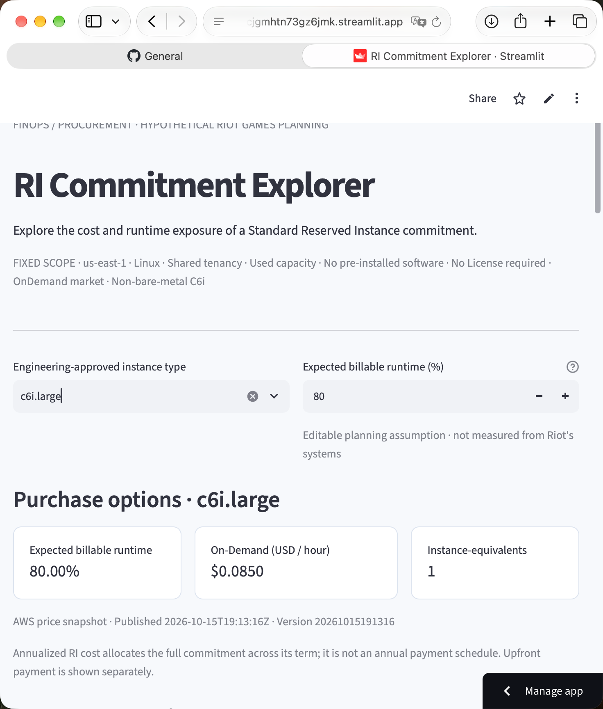
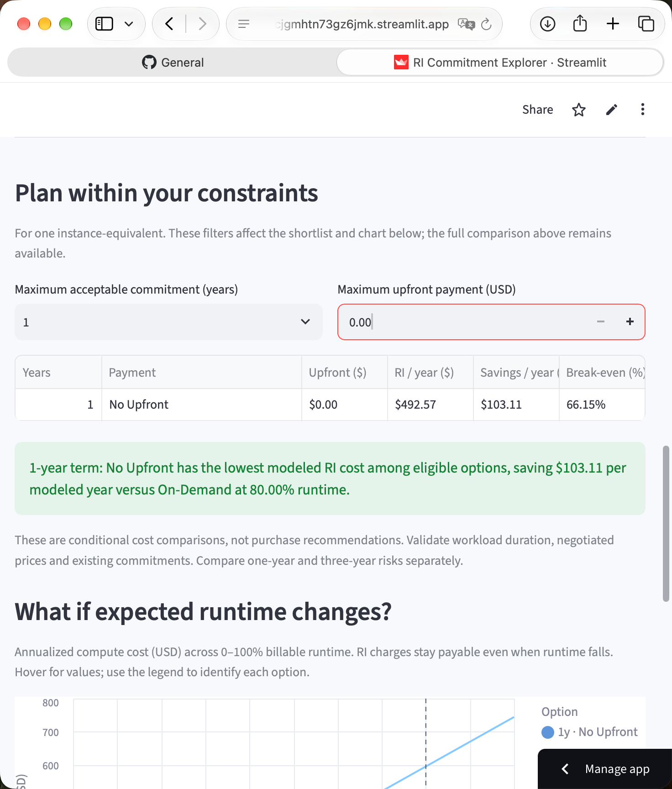
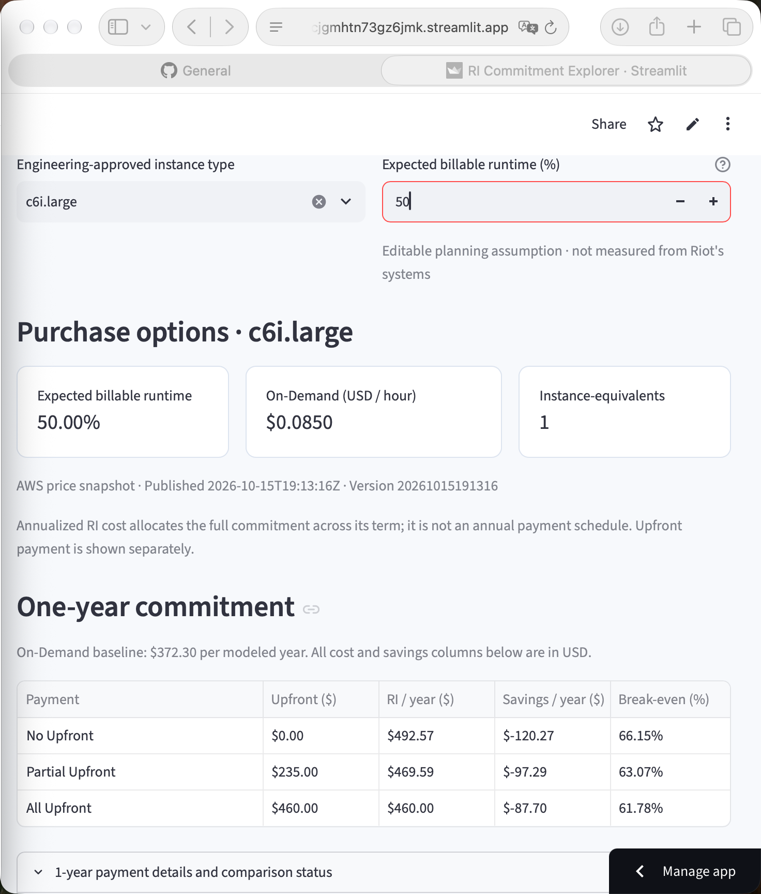
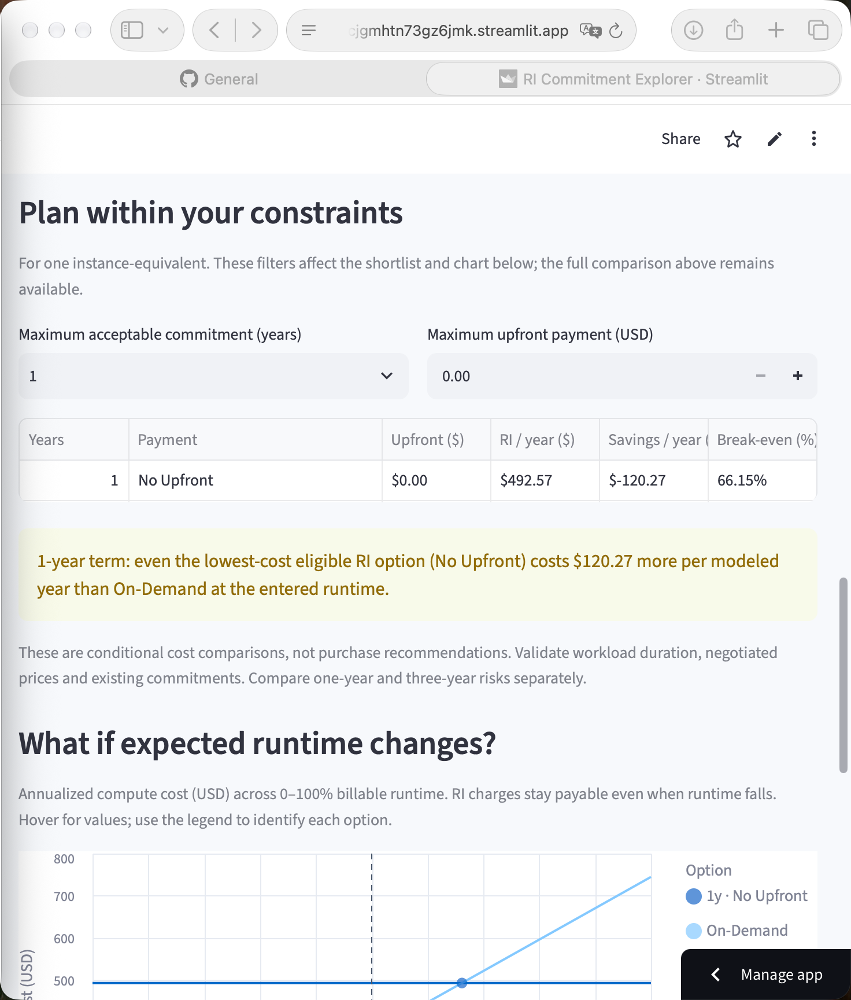

## 4. Tests

### 4.1 Observed execution result

The contributor supplied a terminal screenshot from macOS with Python 3.13.9 and pytest 9.1.1, running in the enhanced project directory after applying the chart-test fix. The command was:

```bash
uv run python -m pytest -rs
```

The latest reported result was:

```text
collected 69 items
SKIPPED [1] tests/test_preparation_integration.py:14:
Full raw snapshot is optional for runtime-only checkout
68 passed, 1 skipped in 1.59s
```

This is an observed contributor-run result for that local checkout, not a claim that the authoring environment reran the complete suite or that a specific GitHub commit has passed CI. Earlier output with one failure was superseded by the successful run. The test failed because it queried the wrong internal chart element name; it was corrected from `arrow_vega_lite_chart` to `vega_lite_chart`. The chart width call was also updated from the deprecated `use_container_width` argument to `width="stretch"`. The contributor reported updating both local and GitHub files.

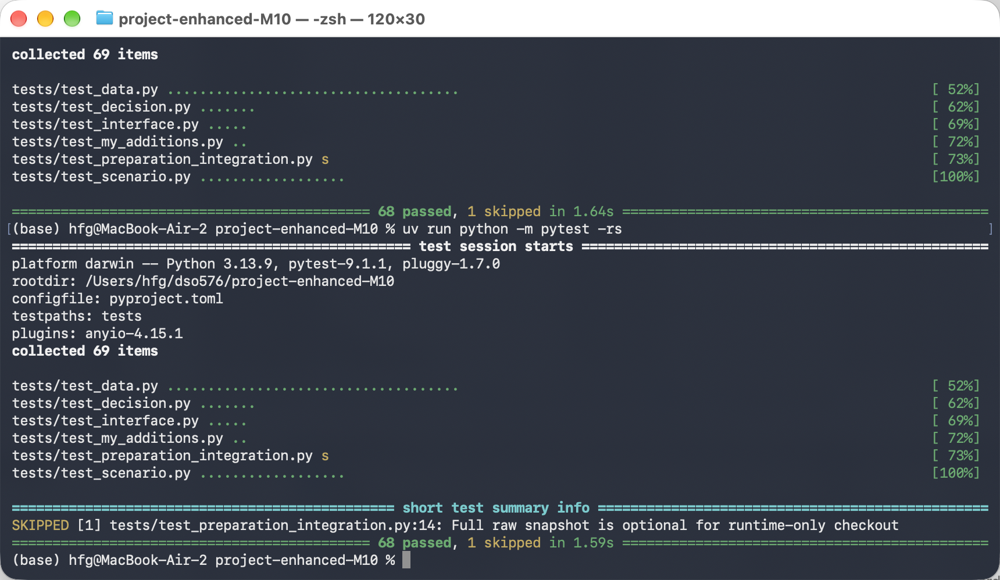

### 4.2 Properties protected by the suite

| Area and file | What the tests check | Why it matters |
|---|---|---|
| Financial fixtures, `tests/test_scenario.py` | Hand-worked savings, equality and loss; one-/three-year terms; all payment types; zero/full runtime; invalid values; break-even above 100%; Decimal precision | Prevents treating hourly discounts as full savings and prevents silently clamping an unattainable threshold |
| Data contracts and pairing, `tests/test_data.py` | Malformed/missing/duplicate components, ambiguous RI groups, missing/nonpositive On-Demand rates, invalid units/currency/terms, scope exclusions and loader failures | Prevents a superficially plausible table built from mismatched or incomplete rates |
| Preparation resilience, `tests/test_data.py` | Source precedence and refresh rules; failed preparation preserves prior published outputs and records failure | Prevents a bad source or failed refresh from silently destroying the usable snapshot |
| View and app interaction, `tests/test_interface.py` | Formatting, source labels, invalid/empty handoffs, controls, cached data refresh, real processed snapshot walkthrough and error state | Checks that displayed figures and interactions reflect the chosen scenario rather than only testing formulas in isolation |
| Additional uploaded tests, `tests/test_my_additions.py` | Selected instance isolation, unchanged input data, and expected runtime/cost relationships across the processed snapshot | Guards against contamination between instance choices and verifies general relationships on actual runtime data |
| New decision support, `tests/test_decision.py` | Inclusive budget boundaries, term filtering, no eligible RI, invalid budgets, independent sensitivity reference and chart-data agreement, plus UI constraint/chart interactions | Protects the new decision filters and the user's path from settings to results |
| Optional full-source integration, `tests/test_preparation_integration.py` | Independent raw-scope reconciliation, RI component counts and agreement with the committed processed table | Would test source-to-handoff preparation on the full raw snapshot; not executed in the reported checkout |

These properties have practical limits. Automated assertions cover specified fixtures and paths; they do not prove the absence of every defect. An internal chart-element check establishes that the app emits a chart in the tested environment, not that every browser renders it legibly. The supplied online screenshots provide a separate visual check for the displayed case states.

### 4.3 What was added beyond the starting build

The new `tests/test_decision.py` contributes **seven executed test cases**: one budget/term-boundary case; one no-eligible-RI case; three parameterized invalid-budget cases; one sensitivity/reference case; and one UI interaction case. These target the new filters and sensitivity chart rather than repeat only the inherited financial fixtures. The UI test selects `c6i.large`, verifies a chart exists, applies a one-year/$0 budget, checks the shortlist, and changes runtime to zero to check the higher-cost warning. Existing interface expectations were adjusted for the additional shortlist table.

The reference case checks the synthetic rates p=$0.20/hour and h=$0.12/hour, so RI annual cost is $1,051.20 and On-Demand at 80% is $1,401.60; it also checks equality at 60% runtime. These are synthetic test fixtures, not the AWS rates in any case. The sensitivity table contains 101 runtime points per eligible option and its values at the entered runtime must agree with the scenario table. The budget test checks exact inclusion at the boundary and exclusion immediately below it, which can change which purchase is feasible.

`test_my_additions.py` was already present in the uploaded project archive. Without additional team history, this validation does not attribute it to the current enhancement work or assume it was absent from the professor's starting build. The team should establish authorship/history before claiming that file as a separate student contribution.

### 4.4 Remaining verification boundaries

The skipped full-source test is a real gap in the reported run, not a passed test. It expects `data/raw/ec2_us-east-1.csv`; without that file it intentionally skips. The app can still run on the processed Parquet, but complete raw-to-processed reconciliation is not established. The separately supplied September archive cannot by itself fill the October snapshot gap.

Five case narratives are integrated. Alex's three case screenshots are included; the originally referenced verification JSON was not supplied. Casey/Maya referenced calculation scripts and evidence logs were not supplied. Their stated arithmetic is reproducible in Section 3.5, but that does not validate the absent files. Contributors report live observations; this integration does not establish anonymous access today or an exact deployed commit. Verify the final public app and all links, confirm case authorship and scenario ownership, and export the finished report as `validation.pdf`. No actual Riot user research, measured user benefit, full-cost coverage or optimization across all AWS products is claimed.
